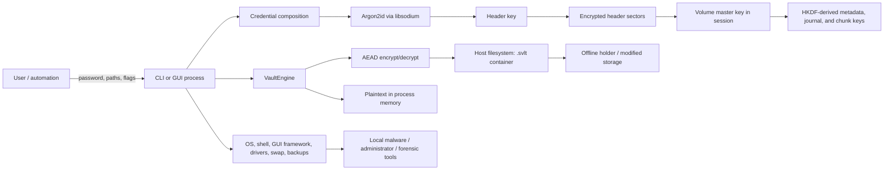

# Shadow Vault Threat Model

**Status:** Implementation-aligned model; includes an unresolved critical cryptographic finding  
**Product baseline:** repository version 1.2.0; validate claims against the exact build and commit in use  
**Scope:** `.svlt` file containers, the CLI, optional Qt GUI, portable configuration, hidden-volume support, recovery tooling, and the optional mount layer  
**Out of scope:** system-disk encryption and pre-boot authentication (PBA). PBA code in this repository is a lab/prototype and is not covered by this model as a production security boundary.

This document describes the security properties the current implementation is designed to provide, the boundaries on which those properties depend, and the residual risks that remain. It is not a formal verification result, a certification, or a substitute for review of the precise source and binary being deployed. “Encrypted” is not used here to imply secrecy of every piece of container metadata, secure erasure, rollback protection, endpoint safety, or plausible deniability.

## 1. Security objectives

Shadow Vault aims to provide:

1. **Confidentiality at rest** for file contents, the internal directory manifest, and volume key material when an attacker has a container copy but not usable credentials. This is an intended property, not a claim that every current write sequence satisfies it; see TM-15.
2. **Credential-gated access** to volume master keys using a memory-hard password KDF, optionally combined with keyfiles.
3. **Authenticated encryption** for headers, manifest pages, journal records, and file-data chunks, so unauthorized modification is detected when the affected object is read or verified.
4. **Crash-aware metadata updates** through an authenticated journal and replay/repair paths, subject to the guarantees of the host filesystem and storage device.
5. **Explicit limits** on outer-volume writes after a hidden region has been configured, with an optional additional protection margin.

The implementation does not promise availability against destructive storage, protection from a compromised operating system, secure deletion from host media, freshness/anti-rollback, anonymity, or plausible deniability.

## 2. System boundary and data flow

**Trust boundaries:** user input crosses into application-owned strings; application-owned objects cross into third-party crypto code; the vault process trusts the host OS for memory, filesystem, randomness integration, scheduling, and device I/O; the container is treated as attacker-controlled input on every open; and optional mount integration crosses into kernel/user filesystem drivers supplied by the host.

The container format has cleartext structural fields. A `.svlt` copy exposes its file path/name, total size, region geometry and offsets, salts, KDF metadata stored in superblock fields, checksums, and certain flags. The format reserves fixed header-sector positions, including a hidden-header slot; its contents and initialization state are observable. File names and file metadata *inside* the encrypted manifest, as well as file contents, are encrypted. The external container filename is never hidden by the format.

## 3. Assets and security consequences

| Asset | Where it exists | Security consequence if exposed or altered |
|---|---|---|
| Plaintext file contents | Process memory, GUI/CLI buffers, output files, mounted reads | Direct disclosure; may persist in swap, crash dumps, filesystem journals, snapshots, or backups |
| Volume master key (VMK) | Encrypted headers at rest; `SecureBuffer` in an unlocked session | Grants access to that volume's encrypted metadata and data |
| Header key and KDF secret | Derived during unlock; some transient ordinary buffers | Enables header decryption or lowers the cost of subsequent offline attempts if captured |
| Password and keyfile material | User input, process arguments/files/environment, transient memory | Enables offline access when combined with a container/header copy |
| Encrypted header backups (`.svhdr`) | User-selected host path or backup medium | Offline password-guessing material; can preserve access under a previous credential/header state |
| Internal manifest and journal | Encrypted container regions and decrypted session state | File names, hierarchy, allocation state, and transaction metadata are sensitive when decrypted |
| Hidden-volume data and configuration | Dedicated header and reserved data region; outer metadata | Disclosure, destruction, or inference of use; current format leaks a cleartext hidden-configured flag |
| Container integrity and freshness | Host file plus authenticated regions | Tampering is detected for authenticated records; replay of an older valid whole-container copy is not prevented |
| Host-side paths and usage artifacts | Shell, OS settings, file metadata, recent-file records, logs | Can reveal vault location and usage even when the container's internal manifest is encrypted |
| Build inputs and release artifacts | Source tree, dependencies, toolchain, CI, distribution channels | Compromise can replace the security properties of every runtime control |

## 4. Adversaries and assumptions

### In-scope adversaries

- **Offline container holder:** can copy, retain, inspect, truncate, replace, or modify a `.svlt` file and attempt password guesses without running the application.
- **Untrusted storage provider or removable-media holder:** can observe file size and write activity, destroy data, replay an older copy, or substitute a container.
- **Local unprivileged process:** can inspect accessible process metadata, shell history, user-readable files, and OS-managed recent-item state; actual reach depends on OS isolation and permissions.
- **Privileged local attacker or malware:** can read/modify the application process, capture input, inspect memory, inject code, or alter binaries. Confidentiality is not expected while such an attacker controls the host.
- **Accidental operator or crash:** can supply malformed input, interrupt writes, restore the wrong header, mount the wrong slot, or fill the outer volume toward hidden data.
- **Dependency or build-chain attacker:** can compromise a dependency, compiler, build host, packaging step, signing key, or release channel.

### Assumptions required for the intended protections

- The cryptographic primitives behave as specified and libsodium, the compiler, operating system, and build inputs are not malicious.
- The user supplies a sufficiently strong, non-reused passphrase. A minimum-length check is not an entropy guarantee.
- Passwords/keyfiles remain unavailable to an offline attacker, or are strong enough to resist guessing if a container or header backup is stolen.
- The running host is not controlled by an attacker at the time secrets are entered or plaintext is used.
- Users retain independent, protected backups for availability. Encryption cannot recover data destroyed by hardware failure or an attacker.
- Filesystem and device flush semantics are honored. The application cannot make a dishonest controller or host filesystem provide durable writes.

## 5. Cryptographic and storage controls

The implementation uses libsodium's XChaCha20-Poly1305-IETF AEAD with 24-byte nonces and 16-byte tags. The header key is derived from a password/keyfile secret with Argon2id; the default profiles are defined in `src/sv_vault/src/key_manager.cpp` (desktop: 256 MiB, time cost 3; portable: 64 MiB, time cost 2). The application bounds KDF memory/time values. A `--paranoid` profile in current front ends raises the configured work factors; it is still bounded by implementation limits. Cleartext salt and KDF metadata allow an offline attacker to test guesses.

The current credential combiner hashes the password's UTF-8 bytes with SHA-256, then folds keyfile hashes through HMAC-SHA-256 in the implementation's path-sorted order (`src/sv_keyfile`): each step uses the previous 32-byte value as the HMAC key and the next keyfile hash as the HMAC message. The engine rejects password inputs shorter than 12 bytes. This is a floor, not a password-strength estimator. The source does not normalize password text to Unicode NFC; users must use the same byte sequence when unlocking. Keyfile bytes are hashed, not embedded in the container. A keyfile is an additional credential component, not a replacement for a strong passphrase.

The VMK derives separated keys for manifest pages, journal records, and data chunks with HKDF-SHA-256. Each chunk is authenticated with context including inode ID, chunk index, and manifest generation. The manifest root hash is checked after decrypting manifest pages. Journal records are individually authenticated. The cleartext superblock and journal superblock use CRCs for structural/error detection; CRCs are not cryptographic authenticity checks.

The container's authenticated encryption detects modification of protected records, but it does not provide an external monotonic counter. An attacker can replay an older complete, internally valid container or header backup and the application has no trusted remote state with which to identify rollback. A CRC-valid superblock is not proof that the file is genuine.

## 6. Threat analysis

| ID | Threat and impact | Current controls | Residual risk / operational consequence |
|---|---|---|---|
| TM-01 | **Offline password guessing.** A stolen container can be tested indefinitely. | Argon2id with bounded memory/time cost; random salts; optional keyfiles; no plaintext password is stored in the container. | Weak or reused passphrases remain guessable. Cost parameters are visible and do not make low-entropy credentials safe. Prefer a unique, high-entropy passphrase; protect keyfiles separately. |
| TM-02 | **Container/header tampering.** An attacker changes ciphertext, tags, metadata, or lengths to corrupt or confuse reads. | AEAD tags on headers, manifest pages, journal records, and chunks; structural validation; CRCs; verify/repair workflows. | Tampering can still cause denial of service. CRCs only detect accidental corruption. Parser and recovery code remain part of the attack surface. |
| TM-03 | **Rollback or stale-copy replay.** A previous valid vault image or header is restored. | Per-record authentication and generation/context binding detect some inconsistent mixes. | There is no trusted external freshness state; a complete old valid image can be accepted. Keep independently versioned backups and protect their history. |
| TM-04 | **Compromised host while unlocked.** Malware reads plaintext or captures credentials/VMK. | Password prompts suppress terminal echo; selected key-bearing buffers use `SecureBuffer`; some credential/KDF intermediates are explicitly wiped. | A hostile kernel/admin, keylogger, debugger, injected process, or sufficiently privileged malware can read secrets. `mlock`/`VirtualLock` is best-effort. Plaintext, GUI strings, manifest state, chunk/file vectors, and framework copies are not comprehensively locked or wiped. |
| TM-05 | **Residual plaintext in memory or host storage.** Plaintext is paged, dumped, copied, cached, or written to a host path. | Container file contents are encrypted as authenticated chunks; some sensitive buffers are wiped. | `get`, GUI workflows, and mount reads expose plaintext to ordinary process memory and destination files. Swap/pagefile, hibernation, crash dumps, filesystem journals, snapshots, indexing, and backups are OS-level concerns. Secure deletion is not provided. |
| TM-06 | **Password exposure at the interface.** Credentials appear in argv, shell history, environment, password files, GUI framework memory, or logs. | Interactive CLI secret prompt is available and does not echo; password-file use emits an insecurity warning. | Inline `--password` / `--new-password` values can be visible in process arguments and shell history. Environment variables and password files have their own exposure. Qt strings may be copied and are not guaranteed to be wiped. Use interactive prompts on shared systems. |
| TM-07 | **Hidden-volume inference.** A forensic examiner identifies hidden-volume use or content. | Hidden and outer volumes use separate encrypted headers/VMKs; hidden allocation is reserved in the encrypted outer manifest; outer writes are bounded after configuration. | **Plausible deniability is not a supported security guarantee.** Current `create_hidden_volume()` sets the cleartext `HIDDEN_CONFIGURED` superblock flag and sets `hidden_present` in the outer encrypted header. The fixed hidden-header sector and file-layout/usage patterns are observable. The format's “strict” profile is not exposed as a functional product control in the current application. Treat hidden-volume use as discoverable. |
| TM-08 | **Outer write destroys hidden data.** An outer write reaches storage reserved for the hidden region. | The allocator records a hidden reservation; `check_write_allowed()` enforces the hidden boundary after outer unlock; an optional protection margin blocks writes before the boundary. GUI outer unlock defaults protection on. | CLI and mount users must request protection explicitly where desired. A raw external editor, damaged metadata, an unsupported writer, or a bug outside `VaultEngine` can bypass application checks. Keep backups; do not rely on the margin as a substitute. |
| TM-09 | **Host-usage traces despite portable/no-host-traces mode.** Paths or activity remain on the host. | Configuration disables selected persistence such as recent vault paths and file logging; GUI settings clear its saved recent-vault list when enabled. Mounting is blocked in no-host-traces mode unless explicitly overridden. | This is a reduction in application-managed traces, not an anti-forensics mode. It does not erase historical data or control shell history, OS MRUs, prefetch, swap, crash dumps, file metadata, endpoint monitoring, backups, or traces emitted by drivers and other applications. |
| TM-10 | **Interrupted or torn update.** Power loss leaves metadata/journal state inconsistent. | Journal begin/commit records, dirty-state tracking, replay on open, flush/sync calls, verification, and repair paths. | Durability depends on OS/device semantics; sync errors are logged and some flush paths are best-effort. Recovery can fail after physical damage. Keep backups before repair and destructive operations. |
| TM-11 | **Malicious/malformed container or CLI input.** Crafted lengths, offsets, credentials, or options trigger crash, resource exhaustion, or wrong behavior. | Range/layout validation, bounded KDF costs, bounded keyfile reads/count, typed result errors, and tests/fuzz targets in the repository. | No parser is immune by documentation. A valid but expensive container can consume resources; limits and fuzz coverage are implementation-dependent. Do not open hostile containers in a privileged or sensitive session. |
| TM-12 | **Mount-layer exposure or data loss.** A filesystem client exercises mount callbacks or opens the same file through multiple handles. | Optional read-only mode; mount options; per-filesystem mutex; writes reconcile with current vault contents and refresh other open handles. | The mount layer is optional and experimental, inherits kernel/driver attack surface, and keeps plaintext in ordinary vectors/caches. Platform-specific mount tests and drivers must be evaluated separately. Avoid production use where a filesystem driver is outside the trusted computing base. |
| TM-13 | **Denial of service / destructive repair.** An attacker truncates, deletes, fills, or corrupts the container. | Integrity checking, backup headers, and journal/header repair tools. | Authentication provides no availability. Repair can rewrite state and may discard data; operate on a copy and preserve the original before repair. |
| TM-14 | **Dependency/build/release substitution.** Malicious source or artifact defeats runtime cryptography. | Small declared dependency set; version/tag references in CMake; release signing/checksum materials are present in the repository. | Version tags are not immutable source hashes, and these controls do not establish a reproducible build or independent audit. Verify signatures/checksums using a trusted key obtained independently. The build may fetch dependencies when vendored sources are absent. |
| TM-15 | **AEAD key/nonce reuse when rewriting a file.** Repeated writes can encrypt different plaintext under the same chunk key and nonce, exposing plaintext relationships and undermining authentication. | Chunk keys derive from the VMK and physical `chunk_id`; nonces derive from the inode's `base_nonce` and logical chunk index; manifest generation is included as AAD. | **The current implementation appears to permit reuse.** `VaultEngine::put()` preserves `base_nonce` when replacing an existing inode, while allocation frees old chunk IDs only after writing the replacement. A later replacement can recycle those IDs. For the same inode/chunk index, both the derived key and nonce can then repeat. Changing AAD generation does not make nonce reuse safe. Treat this as a critical issue requiring a corrected key/nonce lifecycle and regression tests before making a confidentiality claim for rewritten data. |

### TM-15: AEAD key/nonce reuse when rewriting a file

The relevant code path derives a chunk key from `chunk_id` via `src/sv_crypto/hkdf.cpp` and uses it in `src/sv_vault/src/chunk_store.cpp`; the chunk nonce is derived from the inode's `base_nonce` plus the logical chunk index. When `VaultEngine::put()` replaces an existing inode, it copies that inode—including its existing `base_nonce`—then allocates replacement chunks while the previous allocation is still marked used. After the replacement write succeeds, it frees the previous chunk range. A subsequent rewrite can allocate that old range again. If the replacement plaintext differs, the same VMK, `chunk_id`, inode ID, base nonce, and chunk index can reproduce the same AEAD key and nonce. Manifest generation changes only the associated data; it does not repair a reused key/nonce pair.

For XChaCha20-Poly1305, nonce uniqueness per key is a cryptographic requirement. Reuse can reveal relationships between plaintexts and compromises the one-time authenticator's security. The source path is `src/sv_vault/src/vault_engine.cpp` (`VaultEngine::put()` and `allocate_chunks()`) together with `src/sv_vault/src/chunk_store.cpp` (`hkdf_chunk_key()` use and `derive_chunk_nonce()`).

**Required resolution:** establish a fresh nonce domain for every rewrite, or otherwise prove that no `(AEAD key, nonce)` pair can recur across successful writes, retries, and crash recovery. Updating AAD or incrementing only the manifest generation is insufficient. Add regression coverage that forces chunk-range recycling across multiple replacements and checks the cryptographic nonce/key invariant.

## 7. Security invariants and review questions

Changes affecting the following invariants require explicit review and tests at the relevant layer:

- No plaintext, password, header key, or VMK is serialized into the container without the intended authenticated-encryption boundary.
- Nonces are not reused with the same AEAD key; key derivation binds distinct object domains and relevant object identity/generation.
- Container-derived offsets, lengths, counts, and allocation ranges are validated before allocation, pointer arithmetic, or I/O.
- Credential failures do not expose secret material through logs or differentiated detailed errors beyond what the product deliberately supports.
- Outer-volume allocation never overlaps the reserved hidden range after a valid hidden configuration is loaded.
- Recovery and repair preserve the original container until the operator has an independently recoverable copy.
- A “no host traces” setting is described only as the concrete application persistence it disables; it must not be represented as erasure or proof of no artifacts.
- Format or key hierarchy changes are versioned and accompanied by migration, compatibility, and recovery analysis.

**Known invariant violation:** the nonce-uniqueness invariant above is not currently established for repeated writes to an existing file; see TM-15. AAD generation binding is not a substitute for unique `(key, nonce)` pairs.

## 8. Scope exclusions

This model does not cover or promise protection against: compromised firmware/boot chain; system-disk encryption; PBA/EFI prototype code; CPU, DRAM, or device firmware attacks; cold-boot or DMA acquisition; traffic analysis on a synchronized/networked copy; coercion or legal compulsion; physical destruction; malicious administrators; bugs in the host OS, Qt, WinFsp, FUSE, or other platform components; or security of a plaintext file after export from the vault.

## 9. Review and evidence

The source-level anchors for this model are `src/sv_crypto`, `src/sv_container`, `src/sv_keyfile`, `src/sv_vault`, `src/sv_recovery`, `src/sv_platform`, `src/sv_portable`, `src/sv_gui`, and `src/sv_mount`. Format details are in [`docs/file-format-spec.md`](docs/file-format-spec.md); key derivation details are in [`docs/key-hierarchy.md`](docs/key-hierarchy.md). Where a design document conflicts with executable behavior, the implementation and this model's explicit limitation take precedence until the design and code are reconciled.

Revisit this model when changing the on-disk format, cryptographic provider, credential handling, hidden-volume behavior, memory management, no-host-traces semantics, mount callbacks, or release/build pipeline. A documentation review is not a cryptographic audit; publish independent audit scope and findings if one is commissioned.
