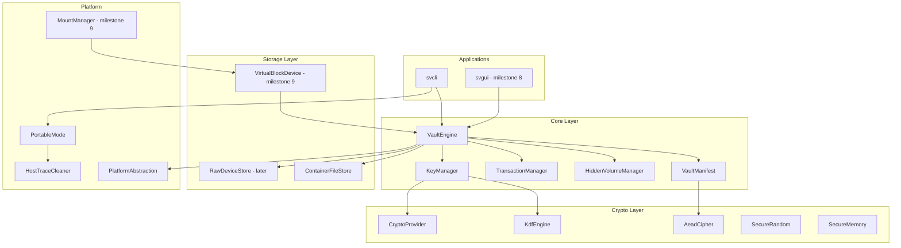

# Shadow Vault — Master Design Document

| Field | Value |
|-------|-------|
| **Title** | Shadow Vault Master Design |
| **Author** | Shadow Vault Engineering |
| **Date** | 2026-07-05 |
| **Status** | Draft (revised 2026-07-05, review 8e7d24de) |
| **Project Root** | `T:\ShadowVault` |

---

## Overview

Shadow Vault is a from-scratch C/C++ encrypted volume application that provides file-hosted and (later) device-hosted cryptographic containers with capabilities comparable to TrueCrypt: hidden volumes, keyfiles, header backup/restore, portable/traveler mode, CLI-first operations, GUI, and eventual virtual-drive mounting. The project deliberately does **not** reuse TrueCrypt source code; it defines a new native container format (`.svlt`) and a modular architecture that can optionally gain legacy compatibility in a future phase.

Version 1 focuses on **portable encrypted file containers**, **CLI operations without mount backends**, and a fully specified on-disk format and crypto architecture. The design prioritizes minimal external dependencies, auditable cryptography, secure memory handling, crash-resistant metadata updates, and cross-platform portability (Windows, Linux, macOS).

---

## Background & Motivation

### Current State

Greenfield project at `T:\ShadowVault` with no existing implementation. Requirements are derived from product goals and TrueCrypt-inspired feature parity, not from TrueCrypt code.

### Pain Points Addressed

| Pain Point | Shadow Vault Response |
|------------|----------------------|
| Legacy TrueCrypt uncertainty | New `.svlt` format; optional future compatibility module |
| Trust in dependencies | Vendored, auditable crypto; no telemetry/cloud |
| Host trace leakage on USB | Portable mode + no-host-traces mode |
| Hidden volume exposure on outer mount | Hidden volume protection + boundary checks |
| Corruption / interrupted writes | Transaction log + triple header sectors + verify/repair |
| Platform fragmentation | `PlatformAbstraction` + backend-specific mount modules (v2+) |

---

## Goals & Non-Goals

### Goals (v1)

- Native `.svlt` container format with byte-level specification
- Password + optional keyfiles → KDF → encrypted headers → volume master key hierarchy
- CLI: create, unlock, lock, put, get, list, remove, rename, mkdir, verify, repair, change-password, keyfile ops, header backup/restore, create-hidden, benchmark, portable-status
- Hidden volume creation, unlock, and protection semantics
- Portable/traveler execution from removable media
- Modular C++20 core with swappable `CryptoProvider`
- Comprehensive test plan and 10-milestone delivery plan
- Architecture amenable to GUI (milestone 8) and mount backends (milestone 9)

### Non-Goals (v1)

- TrueCrypt binary compatibility
- Boot/system encryption, hidden OS, rescue media
- Custom kernel drivers
- Virtual drive mounting (designed, implemented in milestone 9)
- GUI (designed, implemented in milestone 8)
- Online activation, auto-update, telemetry

---

## Proposed Design

### High-Level Architecture



### Repository Layout (`T:\ShadowVault`)

```
T:\ShadowVault\
├── CMakeLists.txt
├── cmake\                    # Toolchains, Find*.cmake, version header
├── docs\                     # All design documents (this set)
├── external\                 # Vendored third-party (libsodium, argon2, etc.)
├── src\
│   ├── sv_common\            # Types, errors, Result<T>, logging macros
│   ├── sv_platform\          # OS abstraction: paths, files, locks, terminal
│   ├── sv_crypto\            # CryptoProvider, KDF, AEAD, random, secure memory
│   ├── sv_container\         # .svlt layout, headers, volume map I/O
│   ├── sv_vault\               # VaultEngine, manifest, file ops, hidden volumes
│   ├── sv_recovery\          # Transaction log, verify, repair
│   ├── sv_keyfile\           # Keyfile format, combiner, validation
│   ├── sv_portable\          # Traveler mode, config, host-trace policy
│   ├── sv_mount\             # MountManager, VirtualBlockDevice (milestone 9)
│   ├── sv_cli\               # CLI entry, command dispatch
│   └── sv_gui\               # GUI (milestone 8; Qt or native per decision)
├── tests\
│   ├── unit\
│   ├── integration\
│   ├── vectors\              # Known-answer test data
│   └── fuzz\
├── tools\
│   ├── sv-bench\             # Standalone benchmark helper
│   └── sv-fuzz-headers\      # LibFuzzer targets
└── packaging\                # Installers, AppImage, etc. (later)
```

Detailed module interactions: see `docs/architecture.md`.

### Core C++ Interfaces

#### Error and Result Types (`src/sv_common/result.hpp`)

```cpp
namespace sv {

enum class ErrorCode : uint32_t {
    Ok = 0,
    InvalidArgument,
    IoError,
    CorruptContainer,
    WrongCredentials,
    HeaderDecryptFailed,
    ManifestDecryptFailed,
    HiddenVolumeProtected,
    TransactionIncomplete,
    ManifestFull,
    UnsupportedVersion,
    PlatformError,
    // ...
};

template<typename T>
class Result {
public:
    static Result ok(T value);
    static Result err(ErrorCode code, std::string message = {});
    bool is_ok() const;
    T& value();
    ErrorCode error() const;
};

} // namespace sv
```

#### CryptoProvider (`src/sv_crypto/crypto_provider.hpp`)

```cpp
namespace sv::crypto {

struct AeadKey { std::array<uint8_t, 32> bytes; };
struct AeadNonce { std::array<uint8_t, 24> bytes; };  // XChaCha20-Poly1305 IETF (libsodium NPUBBYTES)

class CryptoProvider {
public:
    virtual ~CryptoProvider() = default;

    virtual Result<void> aead_encrypt(
        Span<const uint8_t> plaintext,
        Span<const uint8_t> associated_data,
        const AeadKey& key,
        const AeadNonce& nonce,
        Span<uint8_t> ciphertext_out,      // plaintext.size()
        Span<uint8_t> tag_out              // 16 bytes
    ) = 0;

    virtual Result<void> aead_decrypt(
        Span<const uint8_t> ciphertext,
        Span<const uint8_t> associated_data,
        const AeadKey& key,
        const AeadNonce& nonce,
        Span<const uint8_t> tag,
        Span<uint8_t> plaintext_out
    ) = 0;

    virtual Result<void> kdf_argon2id(
        Span<const uint8_t> password,
        Span<const uint8_t> salt,
        KdfParams params,
        Span<uint8_t> derived_key_out
    ) = 0;

    virtual void secure_zero(Span<uint8_t> buffer) = 0;
    virtual Result<void> random_bytes(Span<uint8_t> out) = 0;
    virtual bool constant_time_eq(Span<const uint8_t> a, Span<const uint8_t> b) = 0;
};

// Default implementation: LibsodiumCryptoProvider (vendored libsodium)
std::unique_ptr<CryptoProvider> create_default_crypto_provider();

} // namespace sv::crypto
```

#### VaultEngine (`src/sv_vault/vault_engine.hpp`)

```cpp
namespace sv::vault {

struct UnlockOptions {
    std::string password;
    std::vector<std::filesystem::path> keyfiles;
    bool use_hidden_slot{false};
    bool protect_hidden{false};       // refuse outer writes that encroach hidden
    bool read_only{false};
};

struct CreateOptions {
    uint64_t outer_size_bytes;
    std::optional<uint64_t> hidden_size_bytes;
    KdfParams kdf;
    bool quick_format{false};
};

class VaultEngine {
public:
    static Result<std::unique_ptr<VaultEngine>> create_new(
        const std::filesystem::path& path,
        const CreateOptions& opts,
        CredentialMaterial& creds);

    static Result<std::unique_ptr<VaultEngine>> open(
        const std::filesystem::path& path,
        const UnlockOptions& opts);

    Result<void> lock();
    bool is_unlocked() const;
    bool is_hidden_active() const;

    // File operations (v1 CLI path)
    Result<void> put_file(const std::filesystem::path& vault_rel, const std::filesystem::path& host_src);
    Result<void> get_file(const std::filesystem::path& vault_rel, const std::filesystem::path& host_dst);
    Result<std::vector<DirEntry>> list(const std::filesystem::path& vault_dir);
    Result<void> remove(const std::filesystem::path& vault_rel);
    Result<void> rename(const std::filesystem::path& from, const std::filesystem::path& to);
    Result<void> mkdir(const std::filesystem::path& vault_dir);

    Result<void> verify(bool deep);
    Result<void> repair();
    Result<void> change_password(const CredentialMaterial& old_c, const CredentialMaterial& new_c);
    Result<void> backup_header(const std::filesystem::path& out);
    Result<void> restore_header(const std::filesystem::path& backup);

private:
    std::unique_ptr<container::ContainerHandle> container_;
    std::unique_ptr<crypto::CryptoProvider> crypto_;
    std::unique_ptr<KeyManager> key_manager_;
    SecureBuffer volume_master_key_;
    // ...
};

} // namespace sv::vault
```

#### Container Layer (`src/sv_container/container.hpp`)

```cpp
namespace sv::container {

class ContainerFileStore {
public:
    Result<void> create(const std::filesystem::path& path, uint64_t size);
    Result<ContainerLayout> probe(const std::filesystem::path& path);
    Result<EncryptedHeaderView> read_header(HeaderSlot slot);  // PRIMARY_OUTER, BACKUP_OUTER, HIDDEN
    Result<void> write_header(HeaderSlot slot, const EncryptedHeaderPayload& enc);
    Result<void> read_volume_map(uint64_t offset, Span<uint8_t> buf);
    Result<void> write_volume_map(uint64_t offset, Span<const uint8_t> buf);
    Result<void> read_data(uint64_t abs_offset, Span<uint8_t> buf);
    Result<void> write_data(uint64_t abs_offset, Span<const uint8_t> buf);
};

} // namespace sv::container
```

Full `.svlt` byte layout: see `docs/file-format-spec.md`.  
Key hierarchy: see `docs/key-hierarchy.md`.  
Hidden volumes: see `docs/hidden-volume-design.md`.

### Cryptographic Design Summary

| Layer | Algorithm | Notes |
|-------|-----------|-------|
| KDF | **Argon2id** (v1 only) | m=256 MiB, t=3, p=1 default; tunable at create |
| Header / metadata AEAD | **XChaCha20-Poly1305 IETF** | 256-bit keys, **24-byte nonce** (libsodium `NPUBBYTES`) |
| File chunk AEAD | XChaCha20-Poly1305 IETF | Per-chunk keys via HKDF-SHA256; nonces derived from inode `base_nonce` |
| Random | OS CSPRNG → crypto provider | `/dev/urandom`, `BCryptGenRandom`, etc. |
| Key mixing | HMAC-SHA256 chain | `SHA256(pw)` then `HMAC` per keyfile → KDF input (see `key-hierarchy.md`) |
| Wrong-password detection | AEAD auth failure + **`header_key_confirm`** constant-time check | No early-exit oracle |

**Recommended default Argon2id parameters (desktop):**

- `m_cost` = 262144 (256 MiB)
- `t_cost` = 3
- `p_cost` = 1
- `salt` = 32 bytes (per volume, in cleartext header prefix)
- `derived_key_len` = 64 bytes (bytes 0–31 = `header_key`; bytes 32–63 reserved/unused in v1)

Portable/low-RAM profile: `m_cost` = 65536 (64 MiB), `t_cost` = 2 — user warned at create.

### `.svlt` Container Overview

```
┌──────────────────────────────────────────────────────────────┐
│ Sector 0: Cleartext Superblock (512 bytes)                    │
├──────────────────────────────────────────────────────────────┤
│ Primary Encrypted Header — OUTER (4096 bytes)                 │
├──────────────────────────────────────────────────────────────┤
│ Backup Encrypted Header — OUTER (4096 bytes)                │
├──────────────────────────────────────────────────────────────┤
│ Hidden Encrypted Header — HIDDEN (4096 bytes)                 │
├──────────────────────────────────────────────────────────────┤
│ Transaction / Recovery Journal Area                           │
├──────────────────────────────────────────────────────────────┤
│ Encrypted Volume Manifest (flat sorted inode list, v1)        │
├──────────────────────────────────────────────────────────────┤
│ Data area [data_offset .. data_offset+data_size):             │
│   decoy chunks + [optional] hidden suffix inside data_size    │
├──────────────────────────────────────────────────────────────┤
│ Tail Superblock (512 B, NOT part of data_size)                │
│ container_size = data_offset + data_size + 512                │
└──────────────────────────────────────────────────────────────┘
```

- **Endianness:** All multi-byte integers little-endian.
- **Alignment:** 512-byte sector alignment for header and journal boundaries.
- **Versioning:** `format_version` in superblock; readers reject newer mandatory features.

Full field-level specification: `docs/file-format-spec.md`.

### Volume Map & File Storage

- **Directory tree (v1):** **Flat sorted inode list** in manifest page 0, sorted by `(parent_id, name)`; binary search at runtime (OQ-02 resolved — see `DECISIONS.md` D-04). **Hard cap: 192 inodes** per volume (`SVLT_MAX_INODES_V1`); returns `ManifestFull` when exceeded.
- **File data:** Fixed **1 MiB chunks** in v1 (stored in header).
- **Chunk encryption:** `chunk_key = hkdf_chunk_key(VMK, chunk_id)`; `chunk_nonce = BLAKE2b-256(base_nonce || chunk_index)[0:24]` (no per-chunk nonce on disk).
- **Free space:** 2-bit-per-chunk bitmap in manifest page 1; hidden span marked `10` (hidden reserved) at `create-hidden`; allocations journaled before commit.

### Transaction & Recovery

1. Append intent record to journal (CRC + AEAD wrapper with journal key derived from VMK).
2. Write new manifest pages to shadow region.
3. Commit record updates active manifest pointer in encrypted header (atomic sector write).
4. Truncate journal on clean lock.

Interrupted write recovery: replay journal on unlock; `verify` detects torn writes; `repair` restores from backup header + journal.

### Hidden Volume Semantics (Summary)

- **Three header sectors:** primary OUTER (`0x200`), backup OUTER (`0x1200`), hidden HIDDEN (`0x2200`) — backup always remains outer redundancy (D-05).
- Hidden unlock targets hidden sector only; outer unlock uses primary → backup fallback.
- **Bitmap reservation:** Hidden chunk span marked `10` in outer bitmap at `create-hidden`; outer allocation never enters hidden span.
- **Protection mode:** On outer unlock with `protect_hidden=true`, writes also blocked before `hidden_offset - protect_margin_bytes`.
- Safety margin default: **128 MiB** or 5% of outer data size, whichever is larger (`uint64` in header).

Detail: `docs/hidden-volume-design.md`.

### Portable Mode (Summary)

- Config file `shadowvault.ini` beside executable.
- `portable.enabled=1` disables recent-volume registry, redirects cache to `.shadowvault/cache`.
- `no_host_traces=1` disables shell integration, favorites persistence, crash dumps.

Detail: `docs/portable-mode-design.md`.

### Mount Backends (Future — Milestone 9)

Abstract `MountBackend` with WinFsp/Dokan/FUSE implementations exposing `VirtualBlockDevice` over decrypted chunk cache.

Detail: `docs/mount-backend-design.md`.

### CLI Surface (Summary)

Command `sv` (binary `svcli`): full spec in `docs/cli-spec.md`.

### GUI (Future — Milestone 8)

Screen map in `docs/gui-screen-map.md`.

---

## API / Interface Changes

Greenfield — all interfaces are new. Public stability targets:

| Surface | Stability | Version |
|---------|-----------|---------|
| `.svlt` on-disk format | Frozen at v1.0 after milestone 3 | 1.0 |
| CLI commands | Stable after milestone 5 | 1.0 |
| C++ internal APIs | Unstable until milestone 6 | — |
| Mount IOCTL/path API | Introduced milestone 9 | 0.9 |

---

## Data Model Changes

N/A (new format). Schema evolution rules:

- Minor `format_version` bump: additive optional fields in encrypted payload with feature flags.
- Major bump: new magic subvariant `SVLT2` (hypothetical); v1 uses magic `SVLT`.

Encrypted header plaintext payload is defined **normatively** in `docs/file-format-spec.md` § AEAD Plaintext Payload. Do not duplicate field offsets here; implement from the spec.

Summary fields: `volume_master_key`, `header_key_confirm`, layout offsets, `hidden_offset`/`hidden_max_size` (outer), `hidden_journal_offset`/etc. (hidden slot), `protect_margin_bytes` (uint64).

---

## Alternatives Considered

### 1. LUKS/dm-crypt as Container Format

| Pros | Cons |
|------|------|
| Kernel integration on Linux | No single-file portable semantic; poor hidden volume story |
| Mature | Does not meet USB traveler + manifest-in-file goals |

**Decision:** Rejected for v1 native format.

### 2. AES-256-GCM instead of XChaCha20-Poly1305

| Pros | Cons |
|------|------|
| Hardware AES-NI speed | Nonce reuse catastrophic; 96-bit nonce constraint |
| Industry default | libsodium XChaCha safer for random nonces |

**Decision:** XChaCha20-Poly1305 primary; AES-GCM optional future `CryptoProvider` backend.

### 3. Dokan-only on Windows vs WinFsp-first

| Pros | Cons |
|------|------|
| Dokan simpler API | WinFsp more mature performance/licensing clarity |

**Decision:** WinFsp primary, Dokan fallback (milestone 9). See `mount-backend-design.md`.

### 4. Embedded SQLite for Manifest

| Pros | Cons |
|------|------|
| Rich queries | Extra dependency; harder constant-structure audit |

**Decision:** Rejected; custom encrypted inode map.

---

## Security & Privacy Considerations

See `docs/threat-model.md`. Summary:

- **Assets:** User plaintext, VMK, passwords, keyfiles, hidden volume existence.
- **Threats:** Offline brute force, forensic host traces, hidden volume coercion, torn writes, side channels.
- **Mitigations:** Argon2id, triple header sectors (outer primary, outer backup, hidden), AEAD everywhere, secure memory wipe, portable mode, hidden protection margin, no telemetry.

---

## Observability

| Signal | Mechanism | Notes |
|--------|-----------|-------|
| Structured logs | `SV_LOG(level, component, msg)` | No plaintext paths in portable mode |
| Metrics | Optional counters in benchmark only | No network export |
| Crash handling | Minidumps disabled in no-host-traces | User opt-in elsewhere |
| Audit events | Local log file `shadowvault.log` | Unlock/lock/create only; no file names in hidden-protect mode |

Log levels: Error, Warn, Info, Debug (compile-time stripped in release default).

---

## Rollout Plan

| Phase | Deliverable | Flag |
|-------|-------------|------|
| M1–M2 | Internal CLI skeleton + crypto | — |
| M3 | Alpha `.svlt` create/open | — |
| M4–M5 | Beta file ops | — |
| M6 | Recovery/verify RC | — |
| M7 | Hidden volume RC | `hidden_volume=1` |
| M8 | GUI beta | — |
| M9 | Mount preview | `experimental_mount=1` |
| M10 | Design-only system encryption | — |

Rollback: backup header + journal replay; never auto-migrate containers without user command.

---

## Key Decisions

| ID | Decision | Rationale |
|----|----------|-----------|
| KD-01 | New `.svlt` format, not TC-compatible | Legal/technical clean-room; optional future module |
| KD-02 | Argon2id + XChaCha20-Poly1305 | Modern baseline; libsodium alignment |
| KD-03 | Vendored libsodium + argon2 reference | Minimal auditable deps per policy |
| KD-04 | 512-byte sectors, 4 KiB encrypted headers | Matches disk conventions; room for future fields |
| KD-05 | Triple header sectors (outer primary + outer backup + hidden) | Corruption recovery without sacrificing hidden volume |
| KD-06 | Hidden header at `0x2200`; backup remains outer only | Resolves backup/hidden slot conflict (D-05) |
| KD-16 | Flat sorted inode manifest v1 | Simplicity; B+ tree deferred v1.1 |
| KD-17 | Cleartext 24-byte header nonce prefix | AEAD bootstrap per libsodium XChaCha |
| KD-18 | HMAC-SHA256 credential chain | Normative key mixing |
| KD-19 | Tail superblock **outside** `data_size`; `container_size = data_offset + data_size + 512` | Non-overlap; bootstrap recovery v1 |
| KD-20 | Hidden bitmap reservation + hard boundary | Protects hidden ciphertext on outer mount |
| KD-07 | Fixed 1 MiB chunks v1 | Simplicity; CD chunking deferred |
| KD-08 | CLI-first, GUI milestone 8 | Faster core validation |
| KD-09 | WinFsp-first mount | Performance/licensing on Windows |
| KD-10 | `CryptoProvider` interface | Test vectors + alternative backends |
| KD-11 | C++20 core, C for platform shims | Modern RAII + narrow C interop where needed |
| KD-12 | CMake build + GitHub Actions CI | Cross-platform standard |
| KD-13 | Journal before commit for metadata | Crash consistency |
| KD-14 | Constant-time credential checks | Reduce oracle leakage |
| KD-15 | No network code in core repo | Supply chain + privacy |

---

## PR Plan

Ordered pull requests for implementation phase (post-design):

| PR # | Title | Components / Files | Depends On | Description |
|------|-------|-------------------|------------|-------------|
| 1 | `build: cmake skeleton and sv_common types` | `CMakeLists.txt`, `src/sv_common/*`, `tests/unit/test_result.cpp` | — | Root build, `Result<T>`, error codes, version macros |
| 2 | `platform: path and secure terminal I/O` | `src/sv_platform/*` | PR1 | Cross-platform paths, password entry (no echo), file locks |
| 3 | `cli: command parser and dispatch stub` | `src/sv_cli/*` | PR1–2 | Subcommand routing, `--help`, portable path bootstrap |
| 4 | `crypto: CryptoProvider + libsodium backend` | `src/sv_crypto/*`, `external/libsodium` | PR1 | XChaCha AEAD (24-byte nonce), RNG, secure zero |
| 5 | `crypto: Argon2id KDF + HKDF-SHA256` | `src/sv_crypto/kdf_*`, `hkdf.cpp`, `external/argon2` | PR4 | KDF params, sub-key derivation |
| 6 | `keyfile: loader and HMAC combiner` | `src/sv_keyfile/*` | PR4–5 | Keyfile normalization, credential mixer |
| 7 | `container: superblock and header codec` | `src/sv_container/*`, `tests/unit/test_header.cpp` | PR4–6 | Superblock (incl. tail), 3-header envelope, cleartext nonce |
| 8 | `manifest: flat sorted inode map + bitmap` | `src/sv_vault/manifest_*` | PR7 | Empty manifest, inode page, bitmap page |
| 9 | `recovery: transaction journal` | `src/sv_recovery/*` | PR8 | Journal append/replay/commit — **required before metadata writes** |
| 10 | `vault: create and wrong-password open` | `src/sv_vault/vault_engine.cpp`, `key_manager.cpp` | PR7–9 | `create_new`, `open`, triple-slot probe |
| 11 | `vault: put/get/list file operations` | `src/sv_vault/file_ops_*` | PR10 | Chunk encrypt/write/read via journal |
| 12 | `vault: remove/rename/mkdir` | `src/sv_vault/file_ops_*` | PR11 | Metadata mutations via journal |
| 13 | `vault: verify and repair` | `src/sv_vault/verify_*`, `src/sv_recovery/repair_*` | PR9–12 | Structural + deep verify, repair |
| 14 | `vault: change-password and header backup` | `src/sv_vault/credential_*` | PR10 | Re-header outer (×2) + hidden |
| 15 | `hidden: create/unlock/protect` | `src/sv_vault/hidden_*` | PR10–12 | Hidden sector, bitmap reservation, margin |
| 16 | `portable: traveler mode and host trace cleaner` | `src/sv_portable/*` | PR3 | INI config, cache redirect |
| 17 | `cli: complete command surface` | `src/sv_cli/commands/*` | PR11–16 | All v1 commands wired |
| 18 | `tests: integration and fuzz harness` | `tests/integration/*`, `tests/fuzz/*` | PR13–17 | Mandatory test matrix |
| 19 | `gui: application shell` | `src/sv_gui/*` | PR17 | Milestone 8 — wizards (mount UI disabled until M9) |
| 20 | `mount: WinFsp/FUSE VirtualBlockDevice` | `src/sv_mount/*` | PR17 | Milestone 9 — experimental mount |

---

## Open Questions

| ID | Question | Options | Default if Unresolved |
|----|----------|---------|----------------------|
| OQ-01 | GUI toolkit | **Resolved: Qt 6 LTS** — see `DECISIONS.md` D-01 | — |
| OQ-02 | Manifest structure | **Resolved: flat sorted inode list v1** — D-04 | B+ tree v1.1 |
| OQ-03 | Default volume size preset for wizard | None in v1 CLI-only | User must specify bytes |
| OQ-04 | Empty password with keyfiles? | **Resolved: never** — min 12-char password always — D-03 | — |
| OQ-05 | License | **Resolved: GPLv3** — D-02 | — |
| OQ-06 | Code signing for Windows portable EXE | Authenticode cert cost | Unsigned v1; document SmartScreen |
| OQ-07 | Maximum keyfiles | 256 vs unlimited | Max 64 keyfiles |
| OQ-08 | Expose hidden volume size in outer cleartext? | Plausible deniability | No — only in encrypted outer payload |
| OQ-09 | FIPS mode requirement | Enterprise | Not in v1 |
| OQ-10 | Chunk size user-tunable at create? | 64K–4M | Fixed 1 MiB v1 |

---

## References

| Document | Path |
|----------|------|
| Architecture | `docs/architecture.md` |
| File Format Spec | `docs/file-format-spec.md` |
| Threat Model | `docs/threat-model.md` |
| Key Hierarchy | `docs/key-hierarchy.md` |
| Hidden Volume Design | `docs/hidden-volume-design.md` |
| Portable Mode | `docs/portable-mode-design.md` |
| Mount Backend | `docs/mount-backend-design.md` |
| CLI Spec | `docs/cli-spec.md` |
| GUI Screen Map | `docs/gui-screen-map.md` |
| Build System | `docs/build-system-plan.md` |
| Dependency Policy | `docs/dependency-policy.md` |
| Test Plan | `docs/test-plan.md` |
| Milestone Plan | `docs/milestone-plan.md` |
| Risk Register | `docs/risk-register.md` |
| Recorded Decisions | `docs/DECISIONS.md` |

External prior art (documentation only, no code): TrueCrypt user guide, VeraCrypt format notes, LUKS2 spec, libsodium docs, Argon2 RFC 9106.

---

*End of master design document.*