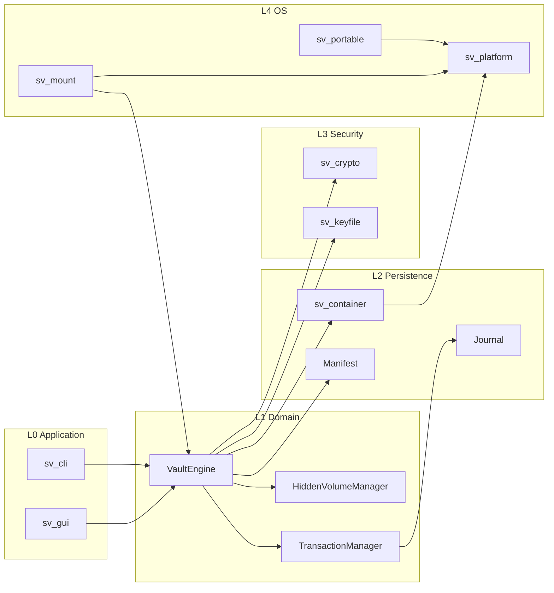
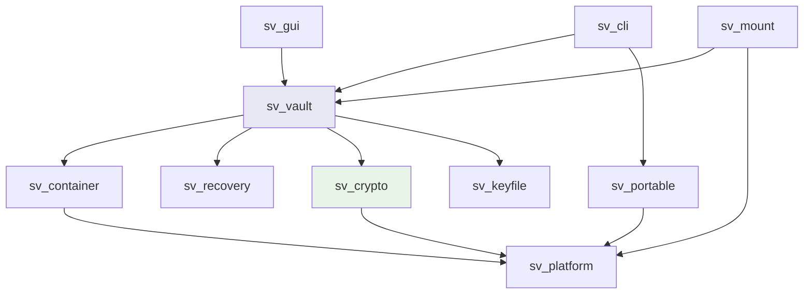
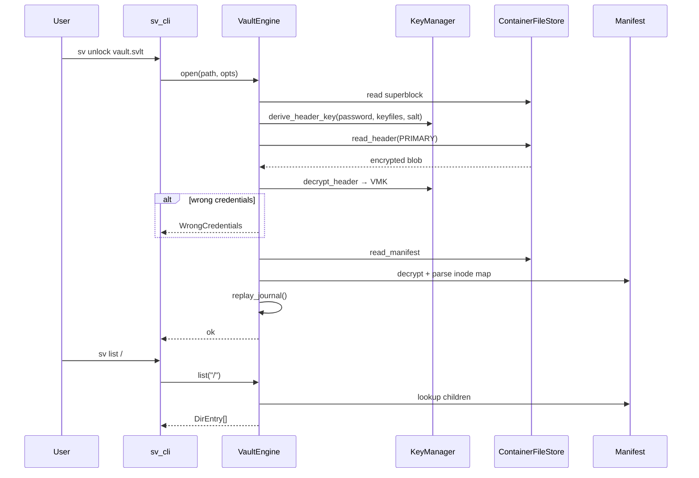
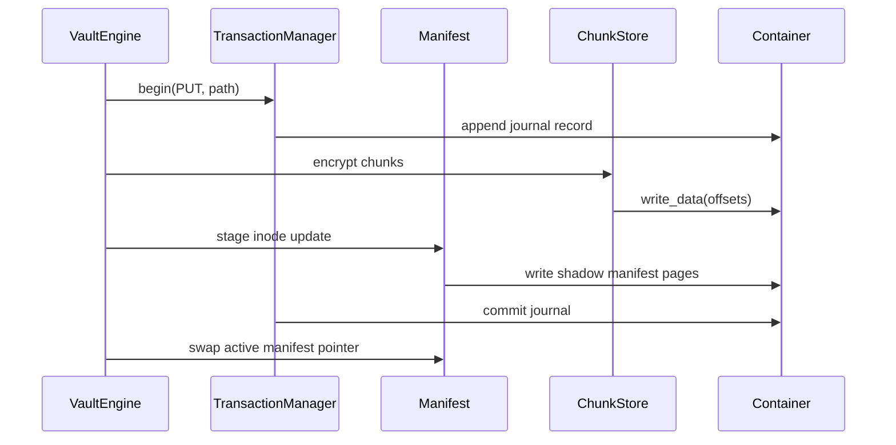

# Shadow Vault — System Architecture

| Field | Value |
|-------|-------|
| **Date** | 2026-07-05 |
| **Status** | Draft |
| **Parent** | `SHADOW-VAULT-DESIGN.md` |

---

## Overview

Shadow Vault is organized as a **layered modular monolith**: applications (CLI, later GUI) call into `VaultEngine`, which orchestrates container I/O, cryptography, manifest management, hidden-volume policy, and recovery. Platform-specific code is isolated behind narrow interfaces. No component in `sv_crypto` or `sv_vault` includes OS headers directly except through `sv_platform`.

---

## Layer Diagram



---

## Module Responsibilities

### `sv_common`

| Unit | Responsibility |
|------|----------------|
| `result.hpp` | `Result<T>`, `ErrorCode` |
| `span.hpp` | Byte spans (GSL-style or std::span) |
| `secure_buffer.hpp` | RAII buffer with wipe-on-destruct |
| `logger.hpp` | Component-tagged logging |
| `version.hpp` | `SV_VERSION`, format version constants |

**Dependencies:** None (STL only).

### `sv_platform`

| Unit | Responsibility |
|------|----------------|
| `paths.cpp` | Config dir, temp dir, executable dir |
| `file_io.cpp` | Sync read/write, preallocate, sparse files |
| `file_lock.cpp` | Exclusive container lock |
| `terminal_secret.cpp` | Password/keyfile path prompt (no echo) |
| `memory_lock.cpp` | `mlock` / `VirtualLock` wrapper |
| `process.cpp` | Single-instance optional mutex |

**Platform splits:** `win32/`, `posix/`, `darwin/` subfolders.

### `sv_crypto`

| Unit | Responsibility |
|------|----------------|
| `crypto_provider.hpp` | Abstract interface |
| `libsodium_provider.cpp` | Default backend |
| `kdf_engine.cpp` | Argon2id/scrypt/PBKDF2 dispatch |
| `hkdf.cpp` | Chunk and journal key derivation |
| `aead.cpp` | Nonce management helpers |
| `secure_random.cpp` | OS RNG |
| `secure_memory.cpp` | Locked pages, wipe |

**Rule:** All cryptographic primitives flow through `CryptoProvider` or `KdfEngine` — no direct OpenSSL/libsodium calls elsewhere.

### `sv_container`

| Unit | Responsibility |
|------|----------------|
| `superblock.cpp` | Cleartext sector 0 codec |
| `header_codec.cpp` | Encrypt/decrypt header payloads |
| `layout.cpp` | Offset calculations from create params (`container_size = data_offset + data_size + 512`) |
| `container_file.cpp` | `ContainerFileStore` implementation |
| `raw_device.cpp` | Block device I/O (stub v1) |

### `sv_vault`

| Unit | Responsibility |
|------|----------------|
| `vault_engine.cpp` | Lifecycle: create/open/lock |
| `key_manager.cpp` | Credential → header key → VMK; header seal/open |
| `credential_material.cpp` | Password + keyfile → KDF input |
| `manifest.cpp` | Encrypted directory tree |
| `inode.cpp` | File metadata records |
| `chunk_store.cpp` | Encrypt/decrypt data chunks |
| `file_ops.cpp` | put/get/list/remove/rename/mkdir |
| `hidden_volume.cpp` | Slot selection, boundary checks |
| `verify.cpp` | Integrity scans |
| `benchmark.cpp` | KDF and AEAD throughput |

### `sv_recovery`

| Unit | Responsibility |
|------|----------------|
| `journal.cpp` | Append-only transaction records |
| `replay.cpp` | Crash recovery on open |
| `repair.cpp` | Header restore, journal truncate |
| `corruption.cpp` | Error classification |

### `sv_keyfile`

| Unit | Responsibility |
|------|----------------|
| `keyfile_format.cpp` | Normalization (512 KiB max read, hash) |
| `combiner.cpp` | HMAC-SHA256 chain over keyfiles |
| `validator.cpp` | Entropy warnings, path checks |

### `sv_portable`

| Unit | Responsibility |
|------|----------------|
| `portable_config.cpp` | INI beside executable |
| `host_trace.cpp` | Registry/history cleanup |
| `traveler_paths.cpp` | Redirect cache, logs, temp |

### `sv_mount` (Milestone 9)

| Unit | Responsibility |
|------|----------------|
| `mount_manager.cpp` | Mount session registry |
| `virtual_block_device.cpp` | Decrypted block facade |
| `chunk_cache.cpp` | LRU decrypted cache |
| `backends/winfsp.cpp` | Windows mount |
| `backends/fuse.cpp` | Linux/macOS mount |

### `sv_cli`

| Unit | Responsibility |
|------|----------------|
| `main.cpp` | Entry, global options |
| `command_registry.cpp` | Subcommand table |
| `commands/*.cpp` | Per-command handlers |
| `output.cpp` | Human/json formatting |

### `sv_gui` (Milestone 8)

| Unit | Responsibility |
|------|----------------|
| `app.cpp` | Application shell |
| `mainwindow.cpp` | Volume list, mount controls |
| `wizards/*.cpp` | Create, hidden create |
| `dialogs/*.cpp` | Password, keyfile, warnings |

---

## Dependency Rules



| Allowed | Forbidden |
|---------|-----------|
| `sv_vault` → `sv_container`, `sv_crypto` | `sv_crypto` → `sv_vault` |
| `sv_cli` → all domain modules | `sv_container` → `sv_vault` |
| `sv_platform` → OS APIs only | `sv_crypto` → network |

---

## Sequence: Unlock and List Files



---

## Sequence: Put File (Transactional)



---

## Folder Structure (Complete)

```
T:\ShadowVault\src\
├── sv_common\
│   ├── include\sv\
│   │   ├── result.hpp
│   │   ├── secure_buffer.hpp
│   │   ├── logger.hpp
│   │   └── version.hpp
│   └── src\
│       └── logger.cpp
├── sv_platform\
│   ├── include\sv\platform\
│   │   ├── paths.hpp
│   │   ├── file_io.hpp
│   │   └── terminal_secret.hpp
│   └── src\
│       ├── posix\
│       └── win32\
├── sv_crypto\
│   ├── include\sv\crypto\
│   │   ├── crypto_provider.hpp
│   │   ├── kdf_engine.hpp
│   │   └── hkdf.hpp
│   └── src\
│       ├── libsodium_provider.cpp
│       ├── kdf_engine.cpp
│       └── hkdf.cpp
├── sv_container\
│   ├── include\sv\container\
│   │   ├── superblock.hpp
│   │   ├── header_codec.hpp
│   │   └── container_file.hpp
│   └── src\
│       ├── superblock.cpp
│       ├── header_codec.cpp
│       └── container_file.cpp
├── sv_vault\
│   ├── include\sv\vault\
│   │   ├── vault_engine.hpp
│   │   ├── manifest.hpp
│   │   └── hidden_volume.hpp
│   └── src\
│       ├── vault_engine.cpp
│       ├── manifest.cpp
│       ├── chunk_store.cpp
│       ├── file_ops.cpp
│       └── hidden_volume.cpp
├── sv_recovery\
│   ├── include\sv\recovery\
│   │   ├── journal.hpp
│   │   └── repair.hpp
│   └── src\
│       ├── journal.cpp
│       └── repair.cpp
├── sv_keyfile\
│   ├── include\sv\keyfile\
│   └── src\
├── sv_portable\
│   ├── include\sv\portable\
│   └── src\
├── sv_mount\
│   ├── include\sv\mount\
│   └── src\backends\
├── sv_cli\
│   ├── main.cpp
│   └── commands\
└── sv_gui\
    └── (milestone 8)
```

---

## Component Interaction Matrix

| Consumer → Provider | sv_common | sv_platform | sv_crypto | sv_container | sv_vault | sv_recovery | sv_keyfile | sv_portable | sv_mount |
|---------------------|-----------|-------------|-----------|--------------|----------|-------------|------------|-------------|----------|
| sv_cli | ✓ | ✓ | — | — | ✓ | — | ✓ | ✓ | ✓ |
| sv_gui | ✓ | ✓ | — | — | ✓ | — | ✓ | ✓ | ✓ |
| sv_vault | ✓ | ✓ | ✓ | ✓ | — | ✓ | ✓ | — | — |
| sv_container | ✓ | ✓ | ✓ | — | — | — | — | — | — |
| sv_recovery | ✓ | ✓ | ✓ | ✓ | — | — | — | — | — |
| sv_mount | ✓ | ✓ | — | — | ✓ | — | — | — | — |
| sv_portable | ✓ | ✓ | — | — | — | — | — | — | — |

---

## Threading Model

| Component | Threads |
|-----------|---------|
| v1 CLI | Single-threaded; container exclusive lock |
| KDF / benchmark | Optional worker pool for parallel Argon2 lanes only |
| Mount backend (M9) | FUSE/WinFsp callback threads → `ChunkCache` mutex |
| GUI (M8) | UI thread + background unlock worker |

**Container lock:** Exclusive `flock` / `LockFile` for writable opens; shared allowed for read-only verify.

---

## Configuration Resolution Order

1. Command-line flags (`--portable`, `--config`)
2. `shadowvault.ini` beside executable (if portable detected)
3. User config dir (`%APPDATA%\ShadowVault`, `~/.config/shadowvault`)
4. Compiled defaults

---

## Extension Points

| Extension | Interface | Phase |
|-----------|-----------|-------|
| Crypto backend | `CryptoProvider` | v1 |
| Container backend | `ContainerStore` (file vs raw device) | v1 file only |
| Mount backend | `MountBackend` | M9 |
| Legacy TC reader | `LegacyContainerAdapter` | Post-v1 |
| Format v2 features | `format_version` + capability flags | v1.1+ |

---

## Build Targets (CMake)

| Target | Type | Description |
|--------|------|-------------|
| `sv_common` | STATIC | Shared types |
| `sv_platform` | STATIC | OS abstraction |
| `sv_crypto` | STATIC | Crypto + KDF |
| `sv_container` | STATIC | Format codec |
| `sv_vault` | STATIC | Core engine |
| `sv_recovery` | STATIC | Journal/repair |
| `sv_keyfile` | STATIC | Keyfile handling |
| `sv_portable` | STATIC | Traveler mode |
| `sv_cli` | EXECUTABLE → output `svcli` | CLI binary; Unix install symlink `sv` |
| `sv_mount` | STATIC | Optional, `SV_BUILD_MOUNT` |
| `svgui` | EXECUTABLE | Optional, `SV_BUILD_GUI` |

---

*Self-contained architecture reference for Shadow Vault v1.*