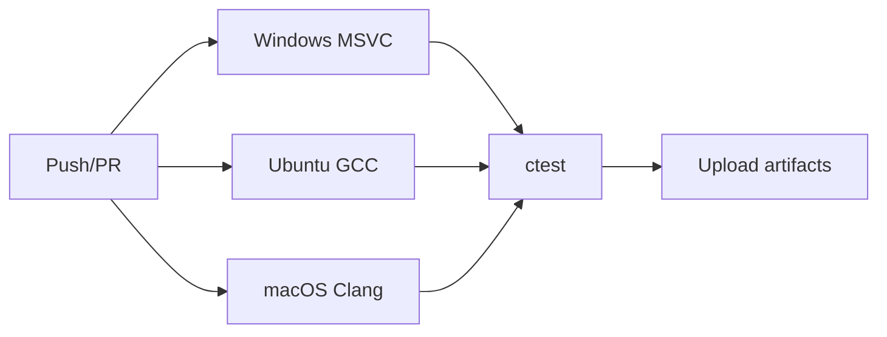

# Shadow Vault — Build System Plan

| Field | Value |
|-------|-------|
| **Date** | 2026-07-05 |
| **Status** | Draft |
| **Build System** | CMake 3.20+ |

---

## Overview

Shadow Vault uses **CMake** for cross-platform builds with optional components (GUI, mount, fuzz tests). The build emphasizes reproducibility, minimal dependencies, and CI on Windows/Linux/macOS.

---

## Repository CMake Layout

```
T:\ShadowVault\
├── CMakeLists.txt              # Root project
├── cmake\
│   ├── ShadowVaultVersion.cmake
│   ├── CompilerWarnings.cmake
│   ├── Sanitizers.cmake
│   ├── Findlibsodium.cmake
│   ├── Findargon2.cmake
│   └── Toolchains\
│       ├── mingw-w64.cmake
│       └── osxcross.cmake
├── external\
│   ├── libsodium\              # Git submodule or vendored tarball
│   └── argon2\                 # PHC reference implementation
└── src\...\CMakeLists.txt
```

---

## Root `CMakeLists.txt` Sketch

```cmake
cmake_minimum_required(VERSION 3.20)
project(ShadowVault VERSION 1.0.0 LANGUAGES C CXX)

set(CMAKE_CXX_STANDARD 20)
set(CMAKE_CXX_STANDARD_REQUIRED ON)
set(CMAKE_C_STANDARD 11)

option(SV_BUILD_CLI "Build CLI" ON)
option(SV_BUILD_GUI "Build Qt GUI" OFF)
option(SV_BUILD_MOUNT "Build mount backends" OFF)
option(SV_BUILD_TESTS "Build tests" ON)
option(SV_BUILD_FUZZ "Build fuzz targets" OFF)
option(SV_USE_VENDORED_LIBSODIUM "Use external/libsodium" ON)
option(SV_ENABLE_ASAN "Address sanitizer" OFF)

include(cmake/CompilerWarnings.cmake)
include(cmake/ShadowVaultVersion.cmake)

add_subdirectory(external)
add_subdirectory(src)

if(SV_BUILD_TESTS)
  enable_testing()
  add_subdirectory(tests)
endif()
```

---

## Targets

| Target | Type | Default |
|--------|------|---------|
| `sv_common` | STATIC | ON |
| `sv_platform` | STATIC | ON |
| `sv_crypto` | STATIC | ON |
| `sv_container` | STATIC | ON |
| `sv_vault` | STATIC | ON |
| `sv_recovery` | STATIC | ON |
| `sv_keyfile` | STATIC | ON |
| `sv_portable` | STATIC | ON |
| `sv_cli` | EXE → output `svcli` | ON |
| `sv_mount` | STATIC | OFF |
| `sv_gui` | EXE → `svgui` | OFF |

**Canonical naming pattern:**

| Artifact | Value |
|----------|-------|
| CMake target | `sv_cli` |
| Source directory | `src/sv_cli/` |
| Output binary | `svcli` (Windows: `svcli.exe`) |
| Unix symlink | `sv` → `svcli` (post-install) |

CI artifacts path: `build/src/sv_cli/svcli` (or `svcli.exe` on Windows).

---

## Compiler Requirements

| Platform | Compiler | Minimum |
|----------|----------|---------|
| Windows | MSVC 2022 or Clang-CL | C++20 |
| Linux | GCC 11+ or Clang 14+ | C++20 |
| macOS | Apple Clang 14+ | C++20 |

### Warning Flags

```cmake
# MSVC: /W4 /permissive-
# GCC/Clang: -Wall -Wextra -Wpedantic -Werror=return-type
```

### Release Builds

- `-O2` (or `/O2`) release
- `-g` debug symbols in RelWithDebInfo
- LTO optional `SV_ENABLE_LTO`

---

## External Dependencies Build

### libsodium (vendored)

```cmake
# external/CMakeLists.txt
if(SV_USE_VENDORED_LIBSODIUM)
  set(SODIUM_MINIMAL ON CACHE BOOL "")
  add_subdirectory(libsodium EXCLUDE_FROM_ALL)
  add_library(sv_libsodium ALIAS sodium)
endif()
```

Configure minimal build: no SSE2 forcing where problematic; enable `AESNI` per platform.

### argon2

```cmake
add_library(argon2 STATIC
  argon2/argon2.c
  argon2/opt.c
  ...
)
target_compile_definitions(argon2 PRIVATE A2_VISCTL=0)
```

---

## Platform-Specific

### Windows

- UTF-8 manifest (`/utf-8`)
- Link `bcrypt`, `advapi32`
- WinFsp: optional `SV_BUILD_MOUNT` + `FindWinFsp.cmake`

### Linux

- Link `pthread`, `dl`
- FUSE3 dev package for mount

### macOS

- `CMAKE_OSX_DEPLOYMENT_TARGET` = 11.0
- macFUSE headers optional

---

## Install Rules

```cmake
install(TARGETS svcli RUNTIME DESTINATION bin)
install(FILES docs/cli-spec.md DESTINATION share/doc/shadowvault)
install(FILES packaging/completion/sv.bash DESTINATION share/bash-completion/completions)
```

Portable distribution: zip with `svcli.exe`, `shadowvault.ini.example`, LGPL licenses.

---

## CI Pipeline (GitHub Actions)



### Workflow Jobs

| Job | Matrix | Steps |
|-----|--------|-------|
| `build-win` | x64 Debug/Release | cmake, build, test |
| `build-linux` | x64 ASAN optional | cmake, build, test |
| `build-macos` | arm64 + x64 | cmake, build, test |
| `fuzz` | nightly | libFuzzer headers only |

**File:** `.github/workflows/ci.yml`

```yaml
name: CI
on: [push, pull_request]
jobs:
  build:
    strategy:
      matrix:
        os: [ubuntu-22.04, windows-2022, macos-13]
        build_type: [Release]
    runs-on: ${{ matrix.os }}
    steps:
      - uses: actions/checkout@v4
        with:
          submodules: recursive
      - name: Configure
        run: cmake -B build -DCMAKE_BUILD_TYPE=${{ matrix.build_type }} -DSV_BUILD_TESTS=ON
      - name: Build
        run: cmake --build build --config ${{ matrix.build_type }}
      - name: Test
        run: ctest --test-dir build -C ${{ matrix.build_type }} --output-on-failure
```

---

## Version Header Generation

```cmake
configure_file(
  cmake/version.hpp.in
  ${CMAKE_BINARY_DIR}/generated/sv/version.hpp
)
```

```cpp
#define SV_VERSION_MAJOR 1
#define SV_VERSION_MINOR 0
#define SV_FORMAT_VERSION 1
```

---

## Sanitizers & Fuzz

| Flag | Use |
|------|-----|
| `SV_ENABLE_ASAN` | Dev CI Linux |
| `SV_ENABLE_UBSAN` | Dev |
| `SV_BUILD_FUZZ` | `tests/fuzz/fuzz_header.cpp` |

Fuzz targets link `sv_container` only.

---

## Reproducible Builds (Goal)

- Pin dependency tarballs with SHA256 in `external/checksums.txt`
- `SOURCE_DATE_EPOCH` for reproducible archives
- Document build environment in release notes

---

## Developer Quick Start

```bash
git clone https://github.com/example/shadowvault.git
cd shadowvault
git submodule update --init --recursive
cmake -B build -DCMAKE_BUILD_TYPE=Debug -DSV_BUILD_TESTS=ON
cmake --build build
ctest --test-dir build --output-on-failure
./build/src/sv_cli/svcli --version
```

Windows PowerShell:

```powershell
cmake -B build -G "Visual Studio 17 2022" -A x64
cmake --build build --config Debug
ctest --test-dir build -C Debug
```

---

## Packaging

| Platform | Format | Build |
|----------|--------|-------|
| Windows | Portable ZIP + MSI (WiX 3.11+) | `scripts/build-installer.ps1` |
| Linux | .tar.xz / AppImage | planned |
| macOS | .dmg unsigned v1 | planned |

Windows MSI features: **Core** (svcli, WinFsp DLL, docs, PATH); **PBA** (optional ShadowVaultBoot.efi + USB scripts).

---

*Self-contained build system plan for Shadow Vault.*