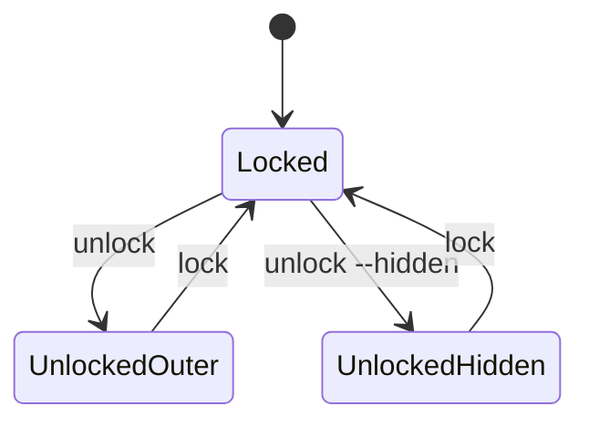

# Shadow Vault — CLI Specification

| Field | Value |
|-------|-------|
| **Binary** | `svcli` (invoked as `sv`) |
| **Date** | 2026-07-05 |
| **Status** | Draft |

---

## Overview

The Shadow Vault CLI (`svcli`) provides non-mounted vault operations in v1. All commands return exit code `0` on success, non-zero on failure. Output formats: human (default) or `--json`.

---

## Global Options

| Option | Description |
|--------|-------------|
| `--help`, `-h` | Show help |
| `--version` | Version and format version |
| `--json` | Machine-readable output |
| `--quiet`, `-q` | Suppress info messages |
| `--verbose`, `-v` | Debug logging |
| `--config PATH` | Config file override |
| `--portable` | Force portable mode |
| `--no-host-traces` | Strict portable |
| `--vault PATH`, `-V` | Default vault path for subcommands |
| `--replace-session` | Replace active unlock session (used by `unlock`) |

### Exit Codes

| Code | Meaning |
|------|---------|
| 0 | Success |
| 1 | General error |
| 2 | Usage error |
| 3 | Wrong credentials |
| 4 | Corrupt container |
| 5 | Hidden volume protected |
| 6 | Vault locked (operation needs unlock) |
| 7 | I/O error |
| 8 | Manifest full (inode cap) |

---

## Command Summary

| Command | Unlock required | Description |
|---------|-----------------|-------------|
| `create` | No | Create new `.svlt` |
| `unlock` / `open` | No | Unlock vault session |
| `lock` / `close` | Session | Lock vault |
| `put` | Yes | Upload file to vault |
| `get` | Yes | Download file from vault |
| `list` | Yes | List directory |
| `remove` | Yes | Delete file/dir |
| `rename` | Yes | Rename/move |
| `mkdir` | Yes | Create directory |
| `verify` | Optional | Integrity check |
| `repair` | Optional | Repair from backup/journal |
| `change-password` | No* | Change credentials |
| `add-keyfile` | No* | Add keyfile requirement |
| `remove-keyfile` | No* | Remove keyfile requirement |
| `backup-header` | No | Export header |
| `restore-header` | No | Import header |
| `create-hidden` | Yes/No** | Create hidden volume |
| `mount` | Yes | Mount (M9) |
| `dismount` | No | Dismount (M9) |
| `benchmark` | No | KDF/AEAD throughput |
| `portable-status` | No | Portable mode info |

\* Prompts for old password if vault locked.  
\** Outer unlock or create-time outer password.

---

## `create`

Create a new encrypted container.

```bash
sv create PATH --size SIZE [options]
```

| Option | Required | Description |
|--------|----------|-------------|
| `--size` | Yes | Total file size (`container_size`) e.g. `10G` — includes headers, journal, manifest, data area, and 512 B tail superblock |
| `--password-prompt` | Default | Interactive password (×2) |
| `--keyfile` | No | Repeatable keyfile paths |
| `--kdf-profile` | No | `desktop` (default), `portable`, `paranoid` |
| `--quick` | No | Sparse/quick format |
| `--chunk-size` | No | Default 1M (v1 fixed) |

**Example:**
```bash
sv create D:\vaults\secret.svlt --size 20G --kdf-profile desktop
```

**JSON output:**
```json
{
  "status": "created",
  "path": "D:\\vaults\\secret.svlt",
  "size": 21474836480,
  "format_version": 1
}
```

---

## `unlock` / `open`

```bash
sv unlock PATH [options]
```

| Option | Description |
|--------|-------------|
| `--hidden` | Unlock hidden volume |
| `--protect-hidden` | Enable hidden protection (outer) |
| `--protect-margin BYTES` | Safety margin |
| `--read-only` | Read-only session |
| `--replace-session` | Replace existing unlock session |
| `--keyfile PATH` | Repeatable |
| `--password-prompt` | Default |

Sessions: single vault per process v1; session keyed by absolute path.

**Example:**
```bash
sv unlock vaults/secret.svlt --protect-hidden
```

---

## `lock` / `close`

```bash
sv lock [PATH]
```

Locks vault, wipes keys, clears session. Default `PATH` from active session.

---

## `put`

```bash
sv put LOCAL_PATH VAULT_PATH [options]
```

| Option | Description |
|--------|-------------|
| `--vault PATH` | Vault if not session default |
| `--hidden` | Target hidden session |
| `--force` | Overwrite existing |

**Example:**
```bash
sv put ./report.pdf /documents/report.pdf --vault secret.svlt
```

---

## `get`

```bash
sv get VAULT_PATH LOCAL_PATH [options]
```

Creates parent dirs for `LOCAL_PATH`. Preserves mtime in vault metadata only.

---

## `list`

```bash
sv list [VAULT_DIR] [options]
```

Default dir: `/`.

**JSON:**
```json
{
  "entries": [
    {"name": "docs", "type": "dir", "mtime": 1717584000},
    {"name": "readme.txt", "type": "file", "size": 42, "mtime": 1717584001}
  ]
}
```

---

## `remove`

```bash
sv remove VAULT_PATH [--recursive] [--force]
```

Directories require `--recursive`.

---

## `rename`

```bash
sv rename FROM TO
```

Both paths vault-relative. Cannot move across incompatible parents if circular.

---

## `mkdir`

```bash
sv mkdir VAULT_DIR [--parents]
```

---

## `verify`

```bash
sv verify [PATH] [--deep] [--structural-only] [--password-prompt]
```

### Verify Modes

| Mode | Credentials | Checks | Exit code |
|------|-------------|--------|-----------|
| **Structural** (default if locked) | None | Superblock primary+tail CRC, region non-overlap, journal superblock CRC, header envelope CRC | 0 ok / 4 corrupt |
| **Crypto shallow** (default if unlocked) | Session or `--password-prompt` | Structural + AEAD decrypt headers + manifest pages + `manifest_root_hash` | 0 ok / 4 corrupt |
| **`--deep`** | Required (unlock or prompt) | Crypto shallow + all allocated chunk AEAD tags | 0 ok / 4 corrupt |

`--structural-only` forces structural mode even if session exists.  
`--locked-ok` is an alias for `--structural-only` (deprecated name).

Manifest AEAD checks **require** VMK — they are not part of structural-only mode.

---

## `repair`

```bash
sv repair PATH [--from-backup] [--replay-journal] [--dry-run]
```

Default: try journal replay, then backup header if primary corrupt.

---

## `change-password`

```bash
sv change-password PATH [options]
```

| Option | Description |
|--------|-------------|
| `--new-password-prompt` | Required |
| `--add-keyfile` | New keyfile |
| `--remove-keyfiles` | Drop keyfile requirement |

Vault must be locked (or will lock after operation).

---

## `add-keyfile` / `remove-keyfile`

```bash
sv add-keyfile PATH --keyfile KPATH
sv remove-keyfile PATH --keyfile KPATH
```

Re-wraps headers with updated `keyfile_required` and KDF input.

---

## `backup-header`

```bash
sv backup-header PATH --output OUT.svhdr [--slot outer|hidden]
```

| `--slot` | Exports | Notes |
|----------|---------|-------|
| `outer` (default) | Primary OUTER sector (`0x200`) | Does not include hidden header |
| `hidden` | Hidden sector (`0x2200`) | Requires knowing hidden exists |

### Examples

```bash
# Export outer header backup (primary copy; restore writes primary+backup)
sv backup-header vault.svlt --output vault-outer.svhdr --slot outer

# Export hidden header (independent of outer backup sector)
sv backup-header vault.svlt --output vault-hidden.svhdr --slot hidden
```

---

## `restore-header`

```bash
sv restore-header PATH --input IN.svhdr [--slot outer|hidden] [--force]
```

| `--slot` | Writes to | Behavior |
|----------|-----------|----------|
| `outer` (default) | Primary + backup OUTER (`0x200`, `0x1200`) | Standard outer recovery |
| `hidden` | Hidden sector (`0x2200`) | Does not modify outer backup |

**Warning:** Incorrect restore can brick vault; prompts confirmation (type `RESTORE`).

---

## `create-hidden`

```bash
sv create-hidden --vault PATH --size SIZE [options]
```

| Option | Description |
|--------|-------------|
| `--size` | Hidden data area size |
| `--margin` | Protection margin (default 128M) |
| `--password-prompt` | Hidden password |

Requires outer vault exists; prompts for outer password if locked.

---

## `mount` (Milestone 9)

```bash
sv mount PATH --point MOUNT [options]
```

| Option | Description |
|--------|-------------|
| `--read-only` | RO mount |
| `--protect-hidden` | Outer only |
| `--allow-host-integration` | Override portable block |

Returns error in v1 build without `SV_BUILD_MOUNT`.

---

## `dismount` (Milestone 9)

```bash
sv dismount [--point MOUNT] [--all]
```

---

## `benchmark`

```bash
sv benchmark [--kdf] [--aead] [--profile desktop|portable|paranoid]
```

Reports ops/sec and MB/s to stdout.

---

## `portable-status`

```bash
sv portable-status [--json]
```

Reports portable detection, paths, blocked features.

---

## Password Input Rules

1. Default: prompt with no echo (`terminal_secret.cpp`)
2. `--password-file PATH`: read first line; **warn** in stderr
3. Environment `SV_PASSWORD`: disabled by default; enable with `--allow-env-password` (testing only)

---

## Session Model (v1)



Only one active unlock per process. Second unlock returns error unless `--replace-session`.

---

## Help Text Template

```
Shadow Vault CLI 1.0.0
Usage: sv <command> [options]

Commands:
  create            Create a new encrypted vault
  unlock|open       Unlock a vault
  lock|close        Lock vault and wipe keys
  put               Add/update file in vault
  get               Extract file from vault
  list              List directory contents
  remove            Remove file or directory
  rename            Rename or move within vault
  mkdir             Create directory
  verify            Verify vault integrity
  repair            Repair corrupted vault
  change-password   Change password/keyfiles
  add-keyfile       Add keyfile to vault
  remove-keyfile    Remove keyfile from vault
  backup-header     Export volume header
  restore-header    Restore volume header
  create-hidden     Create hidden volume
  mount             Mount vault as drive (experimental)
  dismount          Dismount vault
  benchmark         Run crypto benchmark
  portable-status   Show portable mode status

Run 'sv <command> --help' for command help.
```

---

*Normative CLI specification for Shadow Vault v1.*