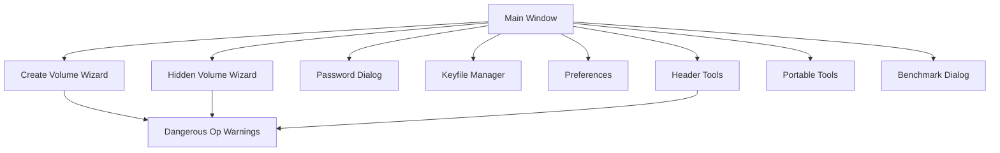
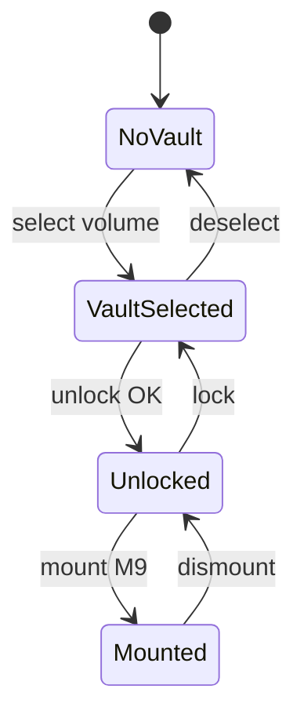

# Shadow Vault — GUI Screen Map

| Field | Value |
|-------|-------|
| **Date** | 2026-07-05 |
| **Status** | Draft |
| **Milestone** | 8 |

---

## Overview

The Shadow Vault GUI (`svgui`) provides graphical access to mount/dismount, volume creation, hidden volumes, preferences, and dangerous-operation warnings. v1 is CLI-only; this document defines screens for milestone 8 implementation.

**Assumed toolkit:** Qt 6 (see Open Question OQ-01 in master doc).

---

## Application Structure



---

## S1: Main Window

**ID:** `mainwindow`  
**File:** `src/sv_gui/mainwindow.cpp`

### Layout

| Zone | Content |
|------|---------|
| Menu bar | File, Volumes, Tools, Portable, Help |
| Toolbar | Mount* , Dismount*, Create, Verify, Preferences (*M9 — disabled gray in M8) |
| Left panel | Volume list (path, state, mount point) |
| Center | Volume details / file browser (post-M9) |
| Status bar | Portable indicator, session count, KDF profile |

### Volume List Columns

| Column | Description |
|--------|-------------|
| Name | File basename |
| Path | Full path (hidden in no-host-traces tooltip) |
| Status | Locked / Unlocked / Mounted |
| Mount | Drive or FUSE path |
| Type | Outer / Hidden |

### Actions

| Action | Shortcut | Opens |
|--------|----------|-------|
| Mount Volume | Ctrl+M | **M9 only** — disabled in M8; shows "Requires milestone 9" |
| Dismount | Ctrl+D | **M9 only** — disabled in M8 |
| Create Volume | Ctrl+N | Create wizard |
| Add to Favorites | Ctrl+F | Disabled portable no-traces |
| Verify | Ctrl+Shift+V | Progress dialog |

---

## S2: Create Volume Wizard

**ID:** `wizard_create_volume`  
**Steps:** 5

### Step 1: Location & Size

- Path browser (`.svlt`)
- Size slider + numeric (GB)
- Filesystem space check
- **Warning:** existing file overwrite

### Step 2: Security

- Password strength meter (zxcvbn or internal heuristic)
- Confirm password
- Keyfile add/remove list
- KDF profile: Desktop / Portable / Paranoid / Custom
- Custom: m_cost, t_cost, p_cost spinners

### Step 3: Format Options

- Quick format vs full allocate
- Chunk size (read-only 1 MiB v1)
- Optional label (stored encrypted manifest root only)

### Step 4: Summary

- Review all choices
- Estimated create time from benchmark cache

### Step 5: Progress

- KDF progress (indeterminate or stepped)
- Header write
- Format manifest
- Cancel disabled during critical writes

---

## S3: Hidden Volume Wizard

**ID:** `wizard_hidden_volume`

### Step 1: Education

- Plausible deniability explanation
- **Warning:** outer volume usage risks
- Checkbox: "I understand"

### Step 2: Outer Authentication

- Outer password + keyfiles
- Verify outer unlock read-only

### Step 3: Hidden Size

- Slider max = planner result
- Shows `hidden_offset` only if "Show technical details"
- Margin default 128 MiB

### Step 4: Hidden Credentials

- Independent password (enforced different from outer recommended)
- Keyfiles optional

### Step 5: Protection & Deniability

- Default: enable protection on future outer mounts
- **Deniability profile:** Standard (default) vs Strict (`deniability_profile=1`, no cleartext `HIDDEN_CONFIGURED`)
- Strict: `hidden_present=0` in outer encrypted header; bitmap reservation still applied

### Step 6: Create Progress

- Same pattern as create wizard

---

## S4: Password Dialog

**ID:** `dialog_password`

| Field | Widget |
|-------|--------|
| Password | `QLineEdit` password echo |
| Keyfiles | List + browse |
| Use hidden volume | Checkbox |
| Protect hidden | Checkbox (outer only) |
| Read-only | Checkbox |
| Cache password session | Off by default; warn |

**Buttons:** OK, Cancel  
**Security:** No clipboard paste by default (setting in preferences).

---

## S5: Keyfile Manager

**ID:** `dialog_keyfile_manager`

- Create random keyfile (256 KiB)
- Import existing file
- Show SHA-256 fingerprint
- Entropy warning if < 128 bytes

---

## S6: Preferences

**ID:** `dialog_preferences`  
**Tabs:**

### General

- Language
- Default KDF profile
- Confirm before dismount

### Security

- Auto-lock idle minutes
- Wipe memory on minimize (experimental)
- Allow password cache (discouraged)

### Mount (M9)

- Default read-only
- Auto-dismount idle
- WinFsp vs Dokan preference

### Portable

- Force portable mode
- No-host-traces
- Cleanup on exit
- Open portable folder button

### Favorites

- List favorite volumes
- Disabled grayed when no-host-traces

### Logging

- Log level
- Log to file path (disabled portable strict)

---

## S7: Header Tools

**ID:** `dialog_header_tools`

| Action | UI |
|--------|-----|
| Backup header | Save `.svhdr` dialog |
| Restore header | Open + **triple warning** |
| View header info | Read-only metadata (slot, KDF id, no VMK) |

**Dangerous Op Warning WR-02** on restore.

---

## S8: Portable Tools

**ID:** `dialog_portable_tools`

- Status: portable / host traces
- One-click cleanup temp
- portable-status equivalent view
- Link to documentation

---

## S9: Benchmark Dialog

**ID:** `dialog_benchmark`

- Run KDF / AEAD tests
- Results table: profile, time, MB/s
- Export results (disabled no-host-traces)

---

## S10: Verify / Repair Progress

**ID:** `dialog_verify_progress`

- Progress bar (chunks verified / total)
- Log pane (errors only in quiet mode)
- Repair offers backup restore if errors found

---

## S11: Mount Point Picker (M9)

**ID:** `dialog_mount_point`

- Windows: drive letter dropdown
- Unix: path entry + browse
- Read-only checkbox
- Host integration warning (portable)

---

## Dangerous Operation Warnings

| ID | Trigger | Message theme |
|----|---------|---------------|
| WR-01 | Quick format + hidden | Hidden may be recoverable if outer filled |
| WR-02 | Restore header | Can destroy data if wrong file |
| WR-03 | Remove keyfiles | Lockout risk |
| WR-04 | Mount outer without protect | Hidden overwrite risk |
| WR-05 | Change password | Interrupt power brick risk — ensure battery |
| WR-06 | Repair dry-run off | Mutating operation |

All use common `DangerousOpDialog` with typed confirmation (e.g., type `RESTORE`).

---

## Menu Map

```
File
  Exit
Volumes
  Mount...
  Dismount
  Create New Volume...
  Create Hidden Volume...
  Add to Favorites
  ─────────
  Verify
  Repair
Tools
  Change Password...
  Keyfile Manager...
  Header Backup / Restore...
  Benchmark...
  Preferences...
Portable
  Portable Status...
  Cleanup Host Traces...
Help
  Documentation
  About Shadow Vault
```

---

## State Machine



---

## Accessibility

- Keyboard navigation all wizards
- Screen reader labels on password fields
- High-contrast icons optional theme

---

*Self-contained GUI screen map for milestone 8.*