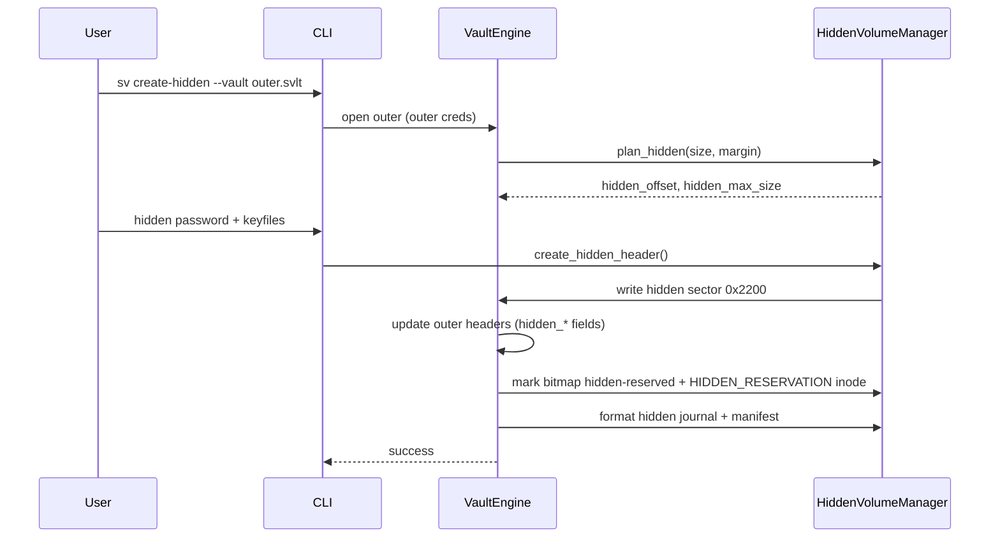

# Shadow Vault — Hidden Volume Design

| Field | Value |
|-------|-------|
| **Date** | 2026-07-05 |
| **Status** | Draft |
| **Milestone** | 7 |
| **Revision** | 2026-07-05 — review 8e7d24de |

---

## Overview

Hidden volumes provide plausible deniability by embedding a second encrypted filesystem inside the outer volume's data area. The hidden volume has independent credentials and VMK. **Hidden volume protection** prevents accidental or malicious overwrite of the hidden region when the outer volume is unlocked.

---

## Header Slot Strategy (Model A — Three Sectors)

| Sector | Offset | Content |
|--------|--------|---------|
| Primary | `0x200` | OUTER header |
| Backup | `0x1200` | OUTER backup (always) |
| Hidden | `0x2200` | HIDDEN header only |

**Unlock logic:**

1. **Outer:** decrypt primary OUTER → on failure, backup OUTER.
2. **Hidden:** decrypt hidden sector (`slot_id=3`, `slot_type=HIDDEN`) only.

Outer backup is **never** overwritten by hidden creation. `change-password` on outer updates primary + backup; hidden password change updates hidden sector only.

See `file-format-spec.md` § Slot Write Policy.

---

## Physical Layout

```mermaid
block-beta
    columns 1
    block headers["Superblock + 3 Headers + Journal + Manifest"]
    block outer_data["Outer Data Area"]
    block hidden_region["Hidden Region"]
    block h_journal["Hidden Journal"]
    block h_manifest["Hidden Manifest"]
    block h_data["Hidden File Data"]
```

```
container_size = data_offset + data_size + 512   // tail is OUTSIDE data_size
decoy_size     = data_size - hidden_max_size
hidden_offset  = data_offset + decoy_size
               = data_offset + data_size - hidden_max_size
tail_offset    = data_offset + data_size = container_size - 512
```

Hidden region `[hidden_offset, data_offset + data_size)` never includes the tail superblock. Chunk allocators must not use `[data_offset + data_size, container_size)`.

Hidden sub-layout offsets stored in **hidden header** fields `hidden_journal_offset` … `hidden_data_size` (see format spec). Worked numeric example: `file-format-spec.md` § Worked Example.

---

## Deniability Profiles

| Profile | Cleartext signals | Outer encrypted fields | Bitmap reservation |
|---------|-------------------|------------------------|-------------------|
| **Standard** (default) | `HIDDEN_CONFIGURED=1` | `hidden_present=1` | Required |
| **Strict** (opt-in) | No `HIDDEN_CONFIGURED` | `hidden_present=0` | Required |

### Runtime `hidden_configured`

Not an on-disk field. After outer unlock, `hidden_configured = true` iff `hidden_max_size > 0` in decrypted outer header **or** `HIDDEN_RESERVATION` inode exists. Both are set at `create-hidden` even in strict mode. See `file-format-spec.md` § Runtime `hidden_configured`.

**Both profiles** enforce hidden protection via:

1. **Outer bitmap:** chunks in `[hidden_start_chunk, hidden_end_chunk)` marked `10` (hidden reserved) at `create-hidden`.
2. **Hard boundary:** outer allocation rejects `chunk_end_byte > hidden_offset` always.
3. **Protection margin:** if `protect_hidden=true`, reject writes with `write_end > hidden_offset - protect_margin_bytes`.

Strict mode hides cleartext hints; encrypted outer header still contains `hidden_offset` after outer unlock (coercion scenario).

---

## Creation Flow



### Constraints at Create

| Check | Rule |
|-------|------|
| Minimum outer size | ≥ 64 MiB + hidden size + margin |
| Minimum hidden size | ≥ 32 MiB |
| No outer chunk overlap | Reject if any outer chunk extends into `[hidden_offset, end)` |
| Bitmap | All hidden-span chunks set to `10` |

---

## Hidden Volume Protection

```cpp
Result<void> HiddenVolumeManager::check_write_allowed(
    uint64_t write_start, uint64_t write_len,
    const OuterContext& outer) const
{
    const uint64_t write_end = write_start + write_len;

    // hidden_configured: see file-format-spec.md (hidden_max_size > 0 OR HIDDEN_RESERVATION inode)
    if (!outer.hidden_configured)
        return Result<void>::ok();

    // Hard boundary — always enforced when hidden exists
    if (write_end > outer.hidden_offset)
        return Result<void>::err(ErrorCode::HiddenVolumeProtected,
            "Write would overlap hidden volume region");

    // Protection margin — coercion scenario
    if (outer.protect_hidden) {
        const uint64_t safe_end = outer.hidden_offset - outer.protect_margin_bytes;
        if (write_end > safe_end)
            return Result<void>::err(ErrorCode::HiddenVolumeProtected,
                "Write would encroach hidden volume safety margin");
    }
    return Result<void>::ok();
}
```

**Default margin:** `max(128 MiB, outer_data_size * 5%)` stored as `uint64` in outer header.

---

## Boundary Checks

| Operation | Check |
|-----------|-------|
| `create-hidden` | No outer chunks in hidden span; bitmap reserved |
| Outer `put` | Bitmap bit ≠ `10`; `chunk_end ≤ hidden_offset`; margin if protect |
| Hidden `put` | Within `hidden_data` sub-area only |

### Chunk Allocation

Outer and hidden use **separate** manifests and bitmaps. Outer bitmap hidden-reservation bits (`10`) are visible only after outer decrypt — acceptable for operational safety.

---

## CLI Integration

```bash
sv create-hidden --vault container.svlt --size 2G --margin 128M
sv unlock container.svlt --hidden
sv unlock container.svlt --protect-hidden
sv backup-header container.svlt --output outer.svhdr --slot outer
sv backup-header container.svlt --output hidden.svhdr --slot hidden
```

### Header Backup Semantics

| `--slot` | Exports | Restore target |
|----------|---------|----------------|
| `outer` | Primary OUTER sector envelope | Primary + backup OUTER |
| `hidden` | Hidden sector envelope | Hidden sector `0x2200` |

Outer backup export never includes hidden header. HV-09 tests outer backup roundtrip with hidden volume present.

---

## Test Cases (Mandatory)

Authoritative list — mirrored in `test-plan.md`:

| Test ID | Description |
|---------|-------------|
| HV-01 | Create hidden in empty outer |
| HV-02 | Hidden unlock lists empty root |
| HV-03 | Outer put near boundary fails with protect |
| HV-04 | Outer put without protect blocked at `hidden_offset` (bitmap) |
| HV-05 | Hidden put/get roundtrip |
| HV-06 | Wrong hidden password fails generic error |
| HV-07 | Outer + hidden different VMK verify |
| HV-08 | Create hidden when outer chunk overlaps → error |
| HV-09 | Outer backup header restore preserves hidden sector |
| HV-10 | Repair outer does not destroy hidden ciphertext |

---

## Resolved Questions

| ID | Resolution |
|----|------------|
| HQ-01 | Hidden-at-start rejected v1 |
| HQ-02 | **Resolved:** third header sector at `0x2200` (D-05) |

---

*Self-contained hidden volume design for Shadow Vault.*