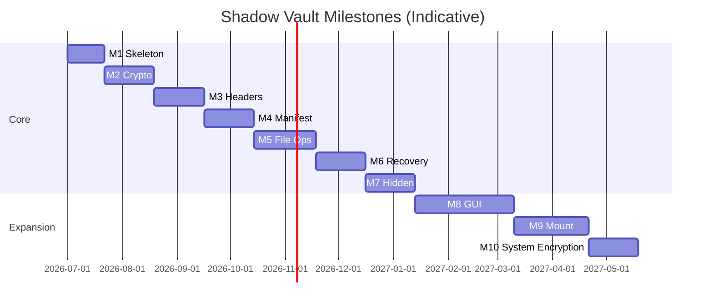

# Shadow Vault — Milestone Plan

| Field | Value |
|-------|-------|
| **Date** | 2026-07-05 |
| **Status** | v1.2 complete (M1–M9, M10 design, PBA lab) |

---

## Overview

Ten implementation milestones define delivery order from skeleton to system-encryption planning. Milestones 1–7 constitute **v1 core**; 8–9 are feature expansion; 10 is design-only future phase.

---

## Timeline Summary

*Dates indicative; adjust per team capacity.*

---

## Milestone 1: Skeleton & CLI Foundation

**Goal:** Runnable CLI skeleton, portable paths, secure password prompt, error handling, file I/O abstraction.

### Deliverables

| Item | Path |
|------|------|
| CMake root + `sv_common` | `CMakeLists.txt`, `src/sv_common/` |
| Platform file I/O | `src/sv_platform/file_io.cpp` |
| Password prompt | `src/sv_platform/terminal_secret.cpp` |
| CLI parser stub | `src/sv_cli/main.cpp`, `command_registry.cpp` |
| Portable detection stub | `src/sv_portable/portable_config.cpp` |

### Acceptance Criteria

- [x] `svcli --version` prints version
- [x] `svcli --help` lists commands (stubs return not implemented)
- [x] Password prompt hides echo on Windows + Linux
- [x] `Result<T>` used consistently
- [x] Unit tests for paths and error types

### Dependencies

None.

---

## Milestone 2: Crypto Wrapper

**Goal:** CryptoProvider, random, KDF, secure buffer, constant-time compare, memory wipe.

### Deliverables

| Item | Path |
|------|------|
| libsodium backend | `src/sv_crypto/libsodium_provider.cpp` |
| Argon2id KDF | `src/sv_crypto/kdf_engine.cpp` |
| SecureBuffer | `src/sv_common/secure_buffer.hpp` |
| Memory lock | `src/sv_crypto/secure_memory.cpp` |
| Known-answer tests | `tests/unit/crypto/` |

### Acceptance Criteria

- [x] C-01 through C-06 tests pass
- [x] Vendored libsodium + argon2 build on Win/Linux/macOS
- [x] No crypto calls outside `sv_crypto`

### Dependencies

M1.

---

## Milestone 3: Vault Creation & Headers

**Goal:** Create `.svlt`, triple header sectors (outer primary/backup + hidden stub), tail superblock, wrong-password detection. Requires keyfile combiner (PR 6) merged first.

### Deliverables

| Item | Path |
|------|------|
| Superblock codec (primary + tail) | `src/sv_container/superblock.cpp` |
| Header codec (cleartext 24-byte nonce) | `src/sv_container/header_codec.cpp` |
| KeyManager | `src/sv_vault/key_manager.cpp` |
| `sv create` command | `src/sv_cli/commands/create.cpp` |
| `sv unlock` partial | `src/sv_cli/commands/unlock.cpp` |
| Golden header vectors | `tests/vectors/` |

### Acceptance Criteria

- [x] `sv create test.svlt --size 64M` produces valid container with empty manifest region
- [x] Wrong password returns exit code 3
- [x] H-01 through H-05 pass
- [x] Format matches `file-format-spec.md` (3 headers, 80-byte AAD, 24-byte nonces)

### Dependencies

M2.

---

## Milestone 4: Encrypted Manifest + Journal

**Goal:** Flat sorted inode list (v1), free bitmap, transaction journal append/replay.

### Deliverables

| Item | Path |
|------|------|
| Manifest codec (flat sorted) | `src/sv_vault/manifest.cpp` |
| Inode records (328 B) | `src/sv_vault/inode.cpp` |
| Journal | `src/sv_recovery/journal.cpp` |
| Chunk index | `src/sv_vault/chunk_store.hpp` (metadata only) |

### Acceptance Criteria

- [x] M-01 through M-04 pass
- [x] Unlock loads empty root directory
- [x] Manifest generation increments on change

### Dependencies

M3.

---

## Milestone 5: File Operations (put/get/list/remove/rename/mkdir)

**Goal:** Complete non-mounted file CLI.

### Deliverables

| Item | Path |
|------|------|
| File ops | `src/sv_vault/file_ops.cpp` |
| Chunk encrypt I/O | `src/sv_vault/chunk_store.cpp` |
| CLI commands | `src/sv_cli/commands/put.cpp`, etc. |

### Acceptance Criteria

- [x] F-01 through F-08 pass
- [x] 1 GiB file roundtrip hash match
- [x] `sv list /` after put shows files
- [x] **No metadata write without journal commit** (gate)

### Dependencies

M4 (manifest + journal).

---

## Milestone 6: Recovery, Verify, Repair

**Goal:** Interrupted-write recovery, integrity verification, corruption handling.

### Deliverables

| Item | Path |
|------|------|
| Journal replay (complete) | `src/sv_recovery/replay.cpp` |
| Verify/repair | `src/sv_vault/verify.cpp`, `src/sv_recovery/repair.cpp` |
| CLI verify/repair | `src/sv_cli/commands/verify.cpp` |

### Acceptance Criteria

- [x] R-01 through R-06 pass
- [x] Simulated power loss during put recovers on reopen
- [x] `sv verify --deep` detects flipped bit

### Dependencies

M5.

---

## Milestone 7: Hidden Volumes

**Goal:** Create, unlock, protect hidden volumes; full test suite.

### Deliverables

| Item | Path |
|------|------|
| Hidden manager | `src/sv_vault/hidden_volume.cpp` |
| create-hidden CLI | `src/sv_cli/commands/create_hidden.cpp` |
| Protection enforcer | integrated in file_ops + chunk_store |

### Acceptance Criteria

- [x] HV-01 through HV-10 pass
- [x] `docs/hidden-volume-design.md` behaviors implemented
- [x] Hidden header sector at `0x2200` works; outer backup preserved

### Dependencies

M6.

**v1 Feature Complete** after M7 (+ credential/header commands from PR 14).

---

## Milestone 8: GUI

**Goal:** Graphical application per `gui-screen-map.md`.

### Deliverables

| Item | Path |
|------|------|
| Qt application | `src/sv_gui/` |
| Wizards | `src/sv_gui/wizards/` |
| Preferences | `src/sv_gui/dialogs/preferences.cpp` |

### Acceptance Criteria

- [ ] Create/unlock/lock/verify flow without CLI (**no OS mount** — mount controls disabled)
- [ ] Hidden volume wizard functional
- [ ] Dangerous op warnings implemented
- [ ] Portable preferences respected

### Dependencies

M7, `SV_BUILD_GUI=ON`. Mount UI wired in M9.

---

## Milestone 9: Mount Backends

**Goal:** WinFsp/FUSE virtual filesystem mount.

### Deliverables

| Item | Path |
|------|------|
| MountManager | `src/sv_mount/mount_manager.cpp` |
| SvFs adapter | `src/sv_mount/svfs.cpp` |
| WinFsp/FUSE backend | `src/sv_mount/backends/fuse_backend.cpp` |
| `sv mount/dismount` | `src/sv_cli/commands/mount.cpp`, `dismount.cpp` |

### Acceptance Criteria

- [x] MT-01 through MT-07 pass (MT-07: OS write via mount)
- [x] Explorer/Finder can copy files via mount (OS read/write validated; CLI blocks until Ctrl+C)
- [x] Auto-dismount works (MT-05)

### Dependencies

M8 (GUI mount controls), M17 (CLI complete). Backend prototyping may start after M7.

---

## Milestone 10: System Encryption Plan (Design Only)

**Goal:** Plan bootloader/pre-boot auth, rescue media, interrupted encryption recovery, hidden OS — **no implementation**.

### Deliverables

| Item | Path |
|------|------|
| System encryption RFC | `docs/rfc-system-encryption.md` |
| Boot auth threat model addendum | `docs/threat-model-system.md` |
| Rescue USB layout spec | `docs/rescue-media-spec.md` |
| Architecture review record | `docs/m10-architecture-review.md` |

### Acceptance Criteria

- [x] Architecture review completed
- [x] Risk register updated with system-encryption items (R-026–R-030)
- [x] Effort estimate for 12+ month phase (12–18 months; see RFC phased plan)
- [x] **No** kernel/driver code merged

### Dependencies

M9.

---

## Phase 1: PBA Prototype (Post-v1.2)

**Goal:** UEFI pre-boot authentication prototype (16 weeks). See `docs/phase1-pba-implementation-plan.md`.

| Item | Path |
|------|------|
| PBA core (host-testable) | `src/sv_pba/core/` |
| Implementation plan | `docs/phase1-pba-implementation-plan.md` |
| EFI loader (Sprint B scaffold) | `src/sv_pba/efi/ShadowVaultPkg/` |

### Acceptance Criteria (in progress)

- [x] P1-00 header inspect unit tests pass (`SV_BUILD_PBA=ON`)
- [x] Sprint A host: `unlock_primary_header` VMK roundtrip + wrong-password (unit P1-02/P1-03)
- [x] Sprint A host: real `.svlt` unlock integration (P1-04/P1-05)
- [x] Sprint B scaffold: EDK2 package, build scripts, QEMU/ESP harness (`scripts/pba-*.ps1`)
- [x] Freestanding C unlock (`sv_pba_freestanding`) — C++ path delegates; host parity test P1-06
- [x] Lab vector export + EFI unlock library (`SvPbaEfiUnlock`, P1-07)
- [x] Setup scripts: `pba-setup-edk2`, `pba-fetch-libsodium`, `pba-verify-lab`
- [x] P1-01 partial: `ShadowVaultBoot.efi` builds + QEMU OVMF boot (banner smoke test)
- [x] P1-02–P1-05 LabUnlock crypto + QEMU chain-load (`LabBootManager.efi` → `bootmgfw.efi`)
- [x] P1-06 rescue USB detect + chain-load (`LabRescue.efi`)
- [x] VMK handoff spike (OQ-S01 / D-15 BS-only UEFI variable)
- [x] P1-03 uniform EFI unlock error (R-009) + QEMU `-TestWrongPassword`
- [x] Physical lab USB staging (`scripts/pba-physical-lab.ps1`)
- [ ] P1-01 physical UEFI laptop boot execution (script ready; needs hardware + lab notes)

---

## Cross-Milestone Commands

| Command | Milestone |
|---------|-----------|
| change-password, keyfile ops | M3–M4 (after headers) |
| backup-header, restore-header | M3 |
| benchmark | M2 |
| portable-status | M1 |

---

## Release Mapping

| Release | Milestones | Tag |
|---------|------------|-----|
| Alpha | M1–M3 | `v0.1.0-alpha` |
| Beta | M4–M6 | `v0.5.0-beta` |
| v1.0 | M7 | `v1.0.0` |
| v1.1 | M8 | `v1.1.0` |
| v1.2 | M9 | `v1.2.0` |

---

*Self-contained milestone plan for Shadow Vault.*