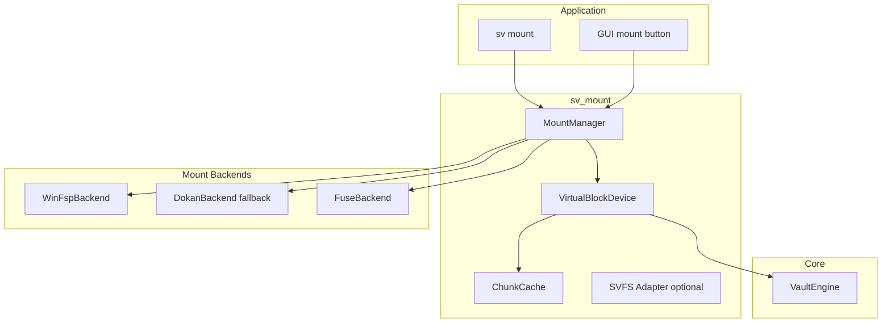

# Shadow Vault — Mount Backend Design

| Field | Value |
|-------|-------|
| **Date** | 2026-07-05 |
| **Status** | Draft |
| **Milestone** | 9 (not v1) |

---

## Overview

Mount backends expose an unlocked Shadow Vault container as a virtual block device or filesystem mount point. **v1 delivers CLI file operations without mounting.** This document specifies the architecture for milestone 9 so core APIs remain mount-ready.

---

## Goals & Non-Goals

### Goals (M9)

- Mount outer/hidden volumes as drive letter (Windows) or FUSE path (Linux/macOS)
- Read-only and read-write mounts
- Auto-dismount on idle / logoff
- Hidden volume protection on mounted outer
- LRU decrypted chunk cache

### Non-Goals (M9)

- Custom kernel driver (use WinFsp/FUSE)
- System encryption
- NTFS driver inside vault (expose as SVFS or pass-through block device)

---

## Architecture



---

## VirtualBlockDevice Interface

```cpp
namespace sv::mount {

struct MountOptions {
    std::filesystem::path mount_point;  // "S:" or "/mnt/sv"
    bool read_only{false};
    bool protect_hidden{false};
    bool auto_dismount{true};
    std::chrono::seconds idle_timeout{900};
    CachePolicy cache;
};

class VirtualBlockDevice {
public:
    virtual ~VirtualBlockDevice() = default;

    virtual Result<size_t> read(uint64_t offset, Span<uint8_t> buf) = 0;
    virtual Result<size_t> write(uint64_t offset, Span<const uint8_t> buf) = 0;
    virtual Result<void> flush() = 0;
    virtual uint64_t size() const = 0;
    virtual bool read_only() const = 0;
};

class MountBackend {
public:
    virtual ~MountBackend() = default;
    virtual std::string name() const = 0;
    virtual Result<void> mount(
        VaultEngine& vault,
        const MountOptions& opts) = 0;
    virtual Result<void> dismount(const std::filesystem::path& mount_point) = 0;
    virtual std::vector<MountSession> list_active() const = 0;
};

} // namespace sv::mount
```

### Block vs Filesystem Mode

| Mode | Description | v1 M9 target |
|------|-------------|--------------|
| **Block device** | Expose raw decrypted linear address space | Optional experimental |
| **SVFS-FUSE** | Translate FS ops → VaultEngine file_ops | **Primary** |

SVFS-FUSE maps `open/read/write/readdir` to existing `VaultEngine` APIs — reuses v1 path.

---

## Chunk Cache

```cpp
struct CachePolicy {
    size_t max_bytes{256 * 1024 * 1024};  // 256 MiB default
    bool drop_on_lock{true};
};

class ChunkCache {
    Result<Span<const uint8_t>> get(chunk_id);
    Result<void> put(chunk_id, Span<const uint8_t> plaintext);
    void invalidate_all();
};
```

- Thread-safe mutex per cache shard
- On lock/dismount: wipe decrypted pages
- Read-only mount: shared cache across handles

---

## Platform Backends

### Windows: WinFsp (Primary)

| Aspect | Choice |
|--------|--------|
| Library | WinFsp 2.x (FSP DLL) |
| API | `FSP_FILE_SYSTEM_INTERFACE` |
| Drive letter | `L"\\ShadowVault\\session{N}"` + assign via `DefineDosDevice` |

**Files:** `src/sv_mount/backends/winfsp.cpp`

**Dependencies:** WinFsp redistributable; document GPL/third-party license.

### Windows: Dokan (Fallback)

If WinFsp unavailable at runtime, try Dokan 2.x.

Trade-off: Dokan less performant; simpler for some users.

### Linux: FUSE3

| Aspect | Choice |
|--------|--------|
| Library | libfuse3 |
| Mount | `fusermount3 -u` dismount |

**Files:** `src/sv_mount/backends/fuse_linux.cpp`

### macOS: macFUSE

| Aspect | Choice |
|--------|--------|
| Library | macFUSE / FUSE-T evaluation |
| Note | macFUSE requires kernel extension user approval |

**Open question:** FUSE-T (userspace NFS bridge) for macOS 13+.

---

## MountManager

```cpp
class MountManager {
public:
    static MountManager& instance();

    Result<MountSessionId> mount_vault(
        std::shared_ptr<VaultEngine> vault,
        MountOptions opts);

    Result<void> dismount(MountSessionId id);
    Result<void> dismount_all();

    void on_idle_tick();  // auto-dismount
};
```

Sessions tracked:

| Field | Description |
|-------|-------------|
| `session_id` | UUID |
| `mount_point` | Path or drive |
| `vault_path` | Container path |
| `read_only` | Flag |
| `last_io_time` | For idle timeout |

---

## Hidden Volume Protection (Mount Path)

On outer mount with hidden configured:

- **Always:** refuse writes past `hidden_offset` (bitmap + hard boundary per `file-format-spec.md`)
- **`protect_hidden`:** also refuse writes before `hidden_offset - protect_margin_bytes`
- `write()` callback delegates to `HiddenVolumeManager::check_write_allowed()`
- Return `STATUS_DISK_FULL` or `ENOSPC` rather than revealing hidden

---

## Auto-Dismount

| Trigger | Action |
|---------|--------|
| Idle timeout | `dismount` + `vault.lock()` |
| Process exit | `atexit` handler dismount all |
| Console logoff (Windows) | `WM_ENDSESSION` hook in GUI |
| `--auto-dismount 0` | Disable |

---

## v1 Non-Mounted CLI Operations

Until M9, all file access via:

```bash
sv unlock vault.svlt
sv put local.txt /docs/local.txt
sv get /docs/local.txt ./out.txt
sv list /
sv lock vault.svlt
```

**Design constraint:** `VaultEngine::file_ops` must not assume mount layer exists.

---

## Portable Mode Interaction

| Setting | Mount behavior |
|---------|----------------|
| `no_host_traces=1` | `sv mount` blocked unless `--allow-host-integration` |
| portable | Warn: mount creates shell shortcuts on some OSes |

---

## CMake Integration

```cmake
option(SV_BUILD_MOUNT "Build mount backends" OFF)
if(SV_BUILD_MOUNT)
  find_package(WINFSP)
  find_package(FUSE3)
  add_library(sv_mount ...)
endif()
```

---

## Testing (M9)

| Test | Description |
|------|-------------|
| MT-01 | Mount roundtrip create file via OS |
| MT-02 | Read-only deny write |
| MT-03 | Dismount releases lock |
| MT-04 | Stress: 10k small files |
| MT-05 | Auto-dismount idle |
| MT-06 | Protect hidden write refusal |

---

## Risks

| Risk | Mitigation |
|------|------------|
| WinFsp not installed | Dokan fallback; clear error |
| macOS kext approval | Document; FUSE-T eval |
| Cache plaintext in RAM | Wipe on dismount; size limits |

---

*Self-contained mount backend design — implementation milestone 9.*