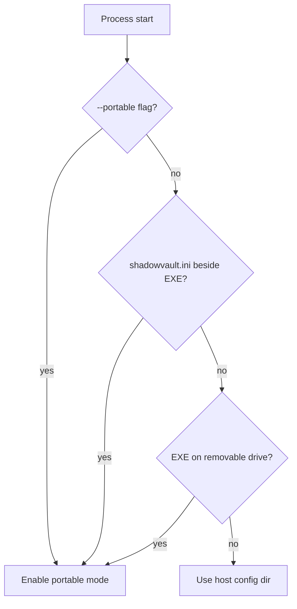

# Shadow Vault — Portable / Traveler Mode Design

| Field | Value |
|-------|-------|
| **Date** | 2026-07-05 |
| **Status** | Draft |

---

## Overview

Portable mode enables Shadow Vault to run from removable media (USB) with configuration stored beside the executable, minimal host integration, and optional **no-host-traces** operation that sacrifices convenience features for reduced forensic footprint.

---

## Goals

| Goal | Implementation |
|------|----------------|
| USB execution | Detect portable layout; relative paths |
| Config portability | `shadowvault.ini` next to `svcli.exe` |
| No recent history | Disable unless opted in |
| Clean exit | Wipe temp, optional registry cleanup |
| Warn on host integration | Mount/admin requires host traces |

---

## Detection Logic



**Implementation:** `src/sv_portable/portable_config.cpp`

```cpp
bool detect_portable_mode(const PlatformContext& ctx) {
    if (ctx.cli_flag_portable) return true;
    if (exists(ctx.exe_dir / "shadowvault.ini")) return true;
    if (ctx.exe_on_removable_volume) return true;
    return false;
}
```

---

## Directory Layout (USB Stick)

```
E:\ShadowVaultPortable\
├── svcli.exe              # Windows CLI
├── svcli                  # Linux/macOS CLI
├── shadowvault.ini        # Portable config
├── .shadowvault\          # Hidden dir (optional)
│   ├── cache\             # Decrypted chunk cache (if enabled)
│   ├── logs\              # Local logs (if enabled)
│   └── temp\              # Scratch space
├── vaults\                # User containers (example)
└── keyfiles\              # Optional keyfile storage
```

---

## Configuration File (`shadowvault.ini`)

```ini
[portable]
enabled=1
no_host_traces=1
cache_enabled=0
log_to_file=0
recent_volumes=0

[paths]
vaults_dir=vaults
keyfiles_dir=keyfiles
temp_dir=.shadowvault\temp

[kdf]
; Override for low-RAM travel laptop
profile=portable

[ui]
language=en
```

### Settings Reference

| Key | Default (portable) | Description |
|-----|-------------------|-------------|
| `enabled` | 1 | Master portable switch |
| `no_host_traces` | 0 | Strict trace avoidance |
| `cache_enabled` | 0 | RAM-only preferred |
| `log_to_file` | 0 in no_host_traces | |
| `recent_volumes` | 0 | No history file |
| `kdf.profile` | `portable` | 64 MiB Argon2id |

---

## Path Resolution

| Resource | Portable | Normal |
|----------|----------|--------|
| Config | `exe_dir/shadowvault.ini` | `%APPDATA%/ShadowVault/config.ini` |
| Recent list | `exe_dir/.shadowvault/recent.json` (if enabled) | User config dir |
| Temp | `exe_dir/.shadowvault/temp` | OS temp / `SV-*` |
| Logs | `exe_dir/.shadowvault/logs` | User config dir |
| Favorites | Disabled in no_host_traces | User config dir |

**Code:** `src/sv_portable/traveler_paths.cpp` hooks `sv_platform::paths`.

---

## No-Host-Traces Mode

When `no_host_traces=1`:

| Feature | Behavior |
|---------|----------|
| Recent volumes | Disabled |
| Windows registry | No writes (except unavoidable — see below) |
| Shell jump lists | Not applicable CLI |
| Crash dumps | Disabled via `SetErrorMode` / `ulimit` |
| Log files | Memory buffer only; discarded on exit |
| Pagefile hints | Best-effort locked memory |
| Favorite volumes | Disabled |
| Benchmark results save | Stdout only |

### Unavoidable Host Traces

| Action | Trace | Mitigation |
|--------|-------|------------|
| Mount drive (M9) | Registry `HKCU\Software\...` | Warn user; require `--allow-host-integration` |
| Admin elevation | Event logs | Warn in portable-status |
| Antivirus scan | AV logs | Outside product control |
| USB insert events | OS logs | Document OPSEC |

```bash
sv portable-status
# Output example:
# portable_mode: active
# no_host_traces: enabled
# host_integration_blocked: mount, favorites
# temp_files_pending: 0
```

---

## Host Trace Cleanup (`src/sv_portable/host_trace.cpp`)

On exit (portable + `cleanup_on_exit=1`):

1. Secure-delete files in portable temp (`overwrite + unlink`)
2. Remove `recent.json` if existed
3. Windows: delete `HKCU\Software\ShadowVault` only if created this session (track flag)
4. Clear environment variables set for session

**Does not:** Clean arbitrary host temp outside portable dir.

---

## Security Considerations

| Threat | Portable response |
|--------|-------------------|
| USB loss | Encryption unchanged; strong password |
| Malicious host | Same as normal — malware risk |
| Forensic host artifacts | Reduced via no_host_traces |
| Swap leakage | Recommend lock before remove USB |

---

## CLI Commands

```bash
sv --portable unlock vaults/secret.svlt
sv portable-status
sv --config E:\ShadowVaultPortable\shadowvault.ini benchmark
```

Global flags:
- `--portable` — force portable mode
- `--no-host-traces` — override INI
- `--config PATH` — explicit INI

---

## Interaction with KDF

Portable profile lowers Argon2id memory for travel laptops:

| Profile | m_cost | t_cost |
|---------|--------|--------|
| desktop | 256 MiB | 3 |
| portable | 64 MiB | 2 |

User warned at `create` if portable profile detected: "Lower RAM cost reduces offline attack cost."

---

## GUI (Milestone 8)

Preferences → Portable tab:
- Toggle no-host-traces
- Open portable folder
- Cleanup now button
- Status indicators (green/yellow/red)

---

## Testing

| Test ID | Description |
|---------|-------------|
| PM-01 | INI beside exe enables portable |
| PM-02 | Recent volumes off by default |
| PM-03 | Temp files cleaned on exit |
| PM-04 | no_host_traces blocks log file |
| PM-05 | Cross-platform path resolution |
| PM-06 | portable-status JSON output |

---

## Open Questions

| ID | Question |
|----|----------|
| PQ-01 | Auto-detect removable drive on macOS APFS external? |
| PQ-02 | Encrypted portable INI for favorites? (Deferred) |

---

*Self-contained portable mode design for Shadow Vault.*