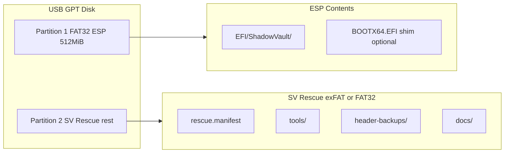

# Shadow Vault — Rescue Media Specification

| Field | Value |
|-------|-------|
| **Date** | 2026-07-05 |
| **Status** | Draft |
| **Milestone** | 10 (design only) |
| **Related** | `docs/rfc-system-encryption.md` |

---

## Overview

Rescue media is a **bootable USB device** used when system encryption prevents normal boot: corrupted headers, interrupted encryption, failed PBA updates, or TPM recovery. The layout mirrors Shadow Vault container philosophy: signed binaries, minimal attack surface, offline-capable `svcli`, and encrypted header backup tools.

**v1 file-container users** may also use a simplified rescue image for header restore — same USB format, fewer boot components.

---

## Design Goals

1. Boot UEFI machines without relying on internal disk ESP
2. Restore system encryption headers (triple-sector pattern)
3. Open `.svlt` containers offline (`svcli` + optional `svgui` if Qt present)
4. Resume or rollback interrupted system encryption
5. Fit on ≥ 1 GiB USB; recommended 4 GiB

---

## Physical Layout



### Partition Table

| Part | Type | Size | FS | Label |
|------|------|------|-----|-------|
| 1 | EFI System (0xEF00) | 512 MiB fixed | FAT32 | `SVRESCUE_ESP` |
| 2 | Basic data (0x0700) | Remainder | exFAT | `SVRESCUE_DATA` |

**Legacy BIOS:** Not supported in v1 system encryption; document "UEFI only."

---

## ESP Directory Structure

```
EFI/
├── BOOT/
│   └── BOOTX64.EFI          # shim or ShadowVaultBoot.efi for firmware fallback
└── ShadowVault/
    ├── ShadowVaultBoot.efi  # PBA + rescue menu
    ├── sv_pba_core.svlib    # static crypto core (signature covered)
    └── version.txt          # SV_RESCUE_1_0_0
```

### Boot Flow

1. User selects USB boot in firmware
2. `ShadowVaultBoot.efi` displays rescue menu:
   - **Boot internal OS** (if headers valid)
   - **Repair encryption**
   - **Restore header from backup**
   - **Open container tools** (chain to mini Linux or Windows PE — phase 2)
3. All options log to `SVRESCUE_DATA:/logs/rescue.log` (no secrets)

---

## Data Partition Structure

```
/
├── rescue.manifest          # Signed manifest (Ed25519)
├── tools/
│   ├── win-x64/
│   │   ├── svcli.exe
│   │   └── svgui.exe        # optional
│   ├── linux-x64/
│   │   └── svcli
│   └── scripts/
│       ├── restore-header.ps1
│       ├── restore-header.sh
│       └── verify-manifest.sh
├── header-backups/          # User copies .svhdr here (empty by default)
│   └── README.txt
├── containers/              # Optional offline .svlt mount point
└── docs/
    ├── QUICKSTART.txt
    └── WR-02-restore-warning.txt
```

---

## rescue.manifest Format

JSON, signed with project release key:

```json
{
  "format": "sv-rescue-manifest",
  "version": 1,
  "build_id": "2026.07.05+sha",
  "files": [
    {
      "path": "tools/win-x64/svcli.exe",
      "sha256": "...",
      "size": 1234567
    }
  ],
  "efi": {
    "path": "EFI/ShadowVault/ShadowVaultBoot.efi",
    "sha256": "..."
  }
}
```

`verify-manifest.sh` fails closed if signature or hashes mismatch.

---

## Header Backup Conventions

| File pattern | Source |
|--------------|--------|
| `system-primary.svhdr` | Primary system header sector dump |
| `system-backup.svhdr` | Backup system header sector |
| `system-recovery.svhdr` | Recovery slot |
| `vault-outer.svhdr` | Container outer header (portable) |

Restore requires typed confirmation `RESTORE` (WR-02). Rescue UI must show **slot** and **target disk** before write.

---

## Interrupted Encryption Recovery Workflow

| Step | Action |
|------|--------|
| 1 | Boot rescue USB |
| 2 | Select **Repair encryption** |
| 3 | PBA reads journal slice; displays state |
| 4 | User chooses **Resume** or **Decrypt to plaintext** (dangerous) |
| 5 | Journal replay; reboot |

Decrypt-to-plaintext requires `DECRYPT-ALL` typed confirmation (new WR-07).

---

## Builder Tooling (future)

```bash
# Conceptual — not implemented in M10
sv rescue-build --output E: --arch x64 --include-cli --sign key.pem
```

| Flag | Effect |
|------|--------|
| `--include-cli` | Copy platform `svcli` into `tools/` |
| `--include-gui` | Copy `svgui` if built |
| `--sign` | Sign manifest + EFI |

---

## Security Requirements

| Req | Detail |
|-----|--------|
| SR-01 | No auto-execution of untrusted scripts from `header-backups/` |
| SR-02 | Passphrase never written to rescue partition |
| SR-03 | Logs redact paths when portable no-host-traces equivalent enabled |
| SR-04 | USB should be hardware-encrypted optional (user responsibility) |
| SR-05 | Dual-boot with attacker-controlled USB → boot order warning in docs |

---

## Size Budget

| Component | Approx size |
|-----------|-------------|
| EFI + PBA | 2–4 MiB |
| svcli win-x64 | 3–8 MiB |
| svcli linux-x64 | 2–6 MiB |
| Docs + scripts | < 1 MiB |
| **Minimum USB** | **1 GiB** |

---

## Testing (when implemented)

| ID | Test |
|----|------|
| RM-01 | Verify manifest rejects tampered svcli |
| RM-02 | UEFI boot on Secure Boot on/off |
| RM-03 | Header restore roundtrip on VM disk |
| RM-04 | Rescue works when internal ESP wiped |
| RM-05 | FAT ESP full — graceful error |

---

## Open Questions

| ID | Question |
|----|----------|
| OQ-R01 | Windows PE vs Linux miniroot for GUI rescue |
| OQ-R02 | Whether to ship shim for all distros |
| OQ-R03 | exFAT vs FAT32 for >4 GiB tools on large USB |

---

*Rescue media layout specification — design only for Milestone 10.*