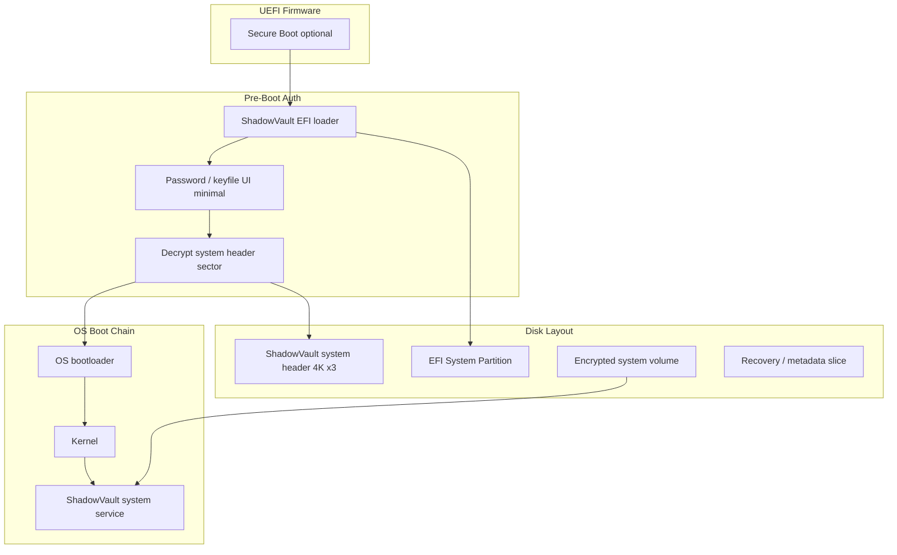

# RFC: Shadow Vault System Encryption

| Field | Value |
|-------|-------|
| **Date** | 2026-07-05 |
| **Status** | Draft — design only (Milestone 10) |
| **Authors** | Shadow Vault Core Team |
| **Implementation** | **None** in v1.x; 12+ month phased program |

---

## Summary

This RFC defines a future **full-disk / system-partition encryption** capability for Shadow Vault, extending the file-container model (`.svlt`) to protect the operating system volume at rest. The design reuses Shadow Vault cryptographic primitives (Argon2id, XChaCha20-Poly1305, triple-header philosophy) while introducing a **pre-boot authentication (PBA)** layer, encrypted boot chain, and rescue/recovery workflows.

**Gate:** No kernel drivers, bootloaders, or firmware modules merge until M10 architecture review and a dedicated implementation milestone (post-v1.2).

---

## Motivation

| Need | Container-only gap |
|------|-------------------|
| Protect OS partition when laptop stolen | `.svlt` does not encrypt Windows/Linux system drive |
| Pre-boot coercion resistance | Host OS may be compromised before unlock |
| Hidden OS / plausible deniability (future) | Requires separate boot path and partition layout |
| Unified crypto policy | Users expect one product for “encrypt my disk” |

System encryption is explicitly a **non-goal for v1** (`SHADOW-VAULT-DESIGN.md`) but must be planned to avoid architectural dead-ends in header format, key hierarchy, and rescue tooling.

---

## Goals

1. Encrypt system partition(s) with Shadow Vault VMK hierarchy
2. PBA before OS loader runs (UEFI-first; legacy BIOS documented as unsupported v1)
3. Survive interrupted encryption (crash/power loss during initial encrypt)
4. Rescue USB for boot repair, header restore, and offline unlock
5. Optional hidden-system partition (phase 3 — design hooks only in phase 1)

## Non-Goals (initial phase)

- TrueCrypt/VeraCrypt partition compatibility
- Custom kernel block filter driver (prefer OS-provided BitLocker-style integration or minimal EFI stub + existing FVE patterns evaluation)
- Network unlock / TPM-only unlock without passphrase (TPM sealing is phase 2)
- macOS system volume encryption (separate RFC)

---

## Architecture Overview

### Disk Layout (conceptual)

| Region | Size | Content |
|--------|------|---------|
| GPT ESP | 100–260 MiB | `ShadowVaultBoot.efi`, fonts, rescue kernel (phase 2) |
| SV system header primary | 4 KiB | Encrypted system metadata (VMK wrap, KDF, volume map) |
| SV system header backup | 4 KiB | Mirror of primary |
| SV system header recovery | 4 KiB | Recovery slot (outer-style triple pattern) |
| System ciphertext area | Remainder | AES/XChaCha sector encryption, 4096-byte sectors |
| Free / hidden reservation | Optional | Hidden OS partition (phase 3) |

Alignment with `.svlt`: reuse **512-byte sector addressing**, **4 KiB encrypted headers**, Argon2id profiles from `key-hierarchy.md`.

---

## Pre-Boot Authentication (PBA)

### Phase 1 — EFI application

| Component | Responsibility |
|-----------|----------------|
| `ShadowVaultBoot.efi` | Chain-load after firmware; own UI framebuffer or simple text |
| `sv_pba_core` (static lib) | Header parse, KDF, VMK unwrap — **no OS dependencies** |
| Credential input | Passphrase + optional keyfile on FAT ESP or USB |

**Flow:**

1. Firmware loads `ShadowVaultBoot.efi` from ESP
2. PBA prompts for credentials (constant-time failure messaging)
3. On success: derive sector keys, install transient decrypt hook or pass VMK blob to next stage via sealed memory (platform-specific)
4. Chain-load Windows `bootmgfw.efi` / shim+GRUB with decrypted access to system partition

### Phase 2 — TPM integration

- Seal VMK to PCR0–7 + user PIN (optional)
- Recovery when TPM reset: rescue USB + backup header

### Open questions

| ID | Question | Target decision |
|----|----------|-----------------|
| OQ-S01 | Windows: partner with existing driver stack vs custom | M10+3 months |
| OQ-S02 | Linux: LUKS coexistence vs native SV system format | M10+2 months |
| OQ-S03 | Hidden OS boot menu exposure | Phase 3 review |

---

## Phased Implementation Plan

| Phase | Duration | Deliverables | Exit criteria |
|-------|----------|--------------|---------------|
| **0 — Design** | 4 weeks (M10) | This RFC, threat addendum, rescue spec, risk register | Architecture sign-off |
| **1 — PBA prototype** | 16 weeks | EFI unlock + read-only mount of test partition | Lab machine boots |
| **2 — In-place encrypt** | 20 weeks | Background encryption service, crash resume | Interrupt test matrix pass |
| **3 — Rescue & recovery** | 12 weeks | USB builder, header restore, repair | WR-02 parity with containers |
| **4 — Hidden system** | 16+ weeks | Dual-boot obfuscation design | Threat review |

**Total estimate:** 12–18 months after M9 completion.

---

## Interrupted Encryption Recovery

Mirrors container journal pattern (`docs/file-format-spec.md`):

1. **Metadata journal** in dedicated slice (encrypted with staging key)
2. States: `PLAINTEXT`, `ENCRYPTING`, `ENCRYPTED`, `DECRYPTING`
3. On resume: replay journal from last committed sector range
4. PBA refuses boot if state is `ENCRYPTING` unless `--allow-partial` rescue mode

---

## Key Hierarchy (system)

Extends `docs/key-hierarchy.md`:

| Key | Scope |
|-----|-------|
| System VMK (SVMK) | Whole system ciphertext area |
| Sector subkeys | HKDF(SVMK, sector_index) — same as chunk derivation |
| Rescue VMK wrap | Separate KDF slot on rescue header sector |
| Hidden system VMK | Independent slot; outer system must not leak presence |

---

## Interaction with File Containers

| Mode | Behavior |
|------|----------|
| Portable `.svlt` | Unchanged |
| System encrypted host | `.svlt` on system drive inherits OS unlock; still separate VMK |
| Rescue USB | Can open `.svlt` offline via `svcli` |

---

## Security Requirements

- No cleartext passwords in EFI variables
- Wipe KDF buffers in PBA before chain-load
- Secure Boot: sign `ShadowVaultBoot.efi`; document dual-signing for Linux shim
- Unified error string for wrong password (R-009)
- Supply chain: separate signed rescue image channel

---

## Testing Strategy (future)

| ID | Test |
|----|------|
| SE-01 | PBA wrong password 1000x constant-time check |
| SE-02 | Power loss at 10/50/90% encryption |
| SE-03 | Rescue USB header restore |
| SE-04 | Secure Boot on/off matrix |
| SE-05 | TPM clear recovery |

---

## References

- `docs/threat-model-system.md` — system encryption threat addendum
- `docs/rescue-media-spec.md` — rescue USB layout
- `docs/key-hierarchy.md` — VMK and KDF profiles
- `docs/risk-register.md` — R-026 through R-030

---

*Design-only RFC — no implementation in repository until post-M10 gate.*