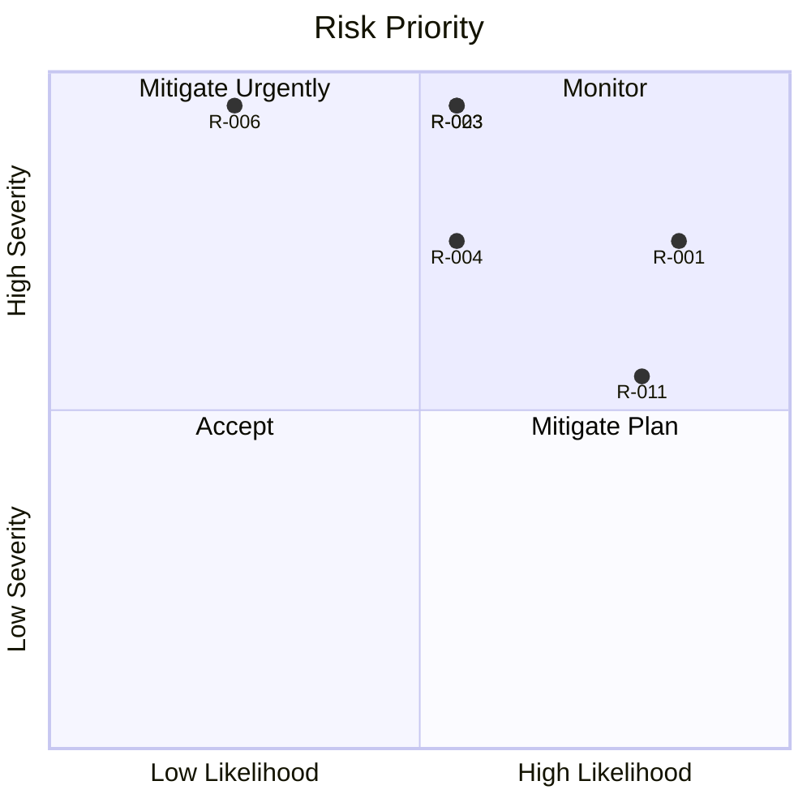

# Shadow Vault — Risk Register

| Field | Value |
|-------|-------|
| **Date** | 2026-07-05 |
| **Status** | Draft |
| **Review Cadence** | Per milestone + quarterly |

---

## Overview

Tracked risks for Shadow Vault v1 with severity, likelihood, mitigation, and owner placeholder. Severity: **Critical / High / Medium / Low**. Likelihood: **High / Medium / Low**.

---

## Risk Matrix

| ID | Risk | Severity | Likelihood | Mitigation | Owner |
|----|------|----------|------------|------------|-------|
| R-001 | Weak user passwords enable offline brute force | High | High | Argon2id 256MiB default; password strength warnings; paranoid profile | Crypto Lead |
| R-002 | Implementation flaw in custom format parser | High | Medium | Fuzz tests; spec review; triple header sectors | Core Lead |
| R-003 | Hidden volume destroyed by outer writes | Critical | Medium | Protection mode; margin; GUI/CLI warnings | Vault Lead |
| R-004 | Interrupted write corrupts manifest | High | Medium | Transaction journal; replay; JOURNAL_DIRTY flag | Recovery Lead |
| R-005 | VMK leakage via swap/pagefile | High | Medium | mlock/VirtualLock; document OS hardening | Platform Lead |
| R-006 | Supply-chain compromise in vendored crypto | Critical | Low | Pin versions; checksums; minimal deps | Security Lead |
| R-007 | Cross-platform behavioral drift | Medium | Medium | CI matrix Win/Linux/macOS; integration tests | DevOps |
| R-008 | Plausible deniability failure (forensics) | High | Medium | Document limits; no cleartext hidden markers | Product |
| R-009 | Wrong-password timing oracle | Medium | Low | Constant-time paths; unified error messages | Crypto Lead |
| R-010 | Keyfile ordering/user confusion | Medium | Medium | Document lexicographic order; CLI lists order | UX Lead |
| R-011 | Portable mode leaves host traces | Medium | High | no_host_traces mode; cleanup; portable-status | Portable Lead |
| R-012 | Scope creep into system encryption early | High | Medium | Milestone 10 design-only gate | PM |
| R-013 | Qt LGPL compliance failure | Medium | Low | Legal review; dynamic linking; notices | Legal/PM |
| R-014 | WinFsp licensing/distribution issues | Medium | Medium | Dokan fallback; license docs in installer | Mount Lead |
| R-015 | macOS FUSE kext deprecation | Medium | High | Evaluate FUSE-T; document user steps | Mount Lead |
| R-016 | Performance inadequate for large files | Medium | Medium | 1 MiB chunks; benchmark; cache at M9 | Performance |
| R-017 | Unicode path bugs on Windows | Medium | Medium | UTF-8 internal; F-08 tests | Platform Lead |
| R-018 | Backup header restore user error bricks vault | High | Low | Triple confirm; dry-run; WR-02 | UX Lead |
| R-019 | Argon2id 256MiB excludes low-RAM devices | Medium | Medium | Portable profile 64MiB; user choice at create | Crypto Lead |
| R-020 | Clean-room claim challenged | High | Low | No TC source; document design provenance | Legal |
| R-021 | Single-threaded CLI throughput limits | Low | High | Accept v1; parallel chunk encrypt later | Core Lead |
| R-022 | Manifest scalability (100k+ files) | Medium | Low | v1 hard cap **199 inodes**; multi-page/B+ tree v1.1 | Vault Lead |
| R-023 | Malware scrapes VMK while unlocked | Critical | Medium | Document threat; auto-lock GUI/M9 | Security Lead |
| R-024 | fuzzer finds crashable parse bugs | High | Medium | Z-01–Z-04; fix before release | QA |
| R-025 | Reproducible build failure | Low | Medium | SOURCE_DATE_EPOCH; pinned deps | DevOps |
| R-026 | Evil maid bootkit replaces PBA EFI binary | Critical | Medium | Secure Boot; signed EFI; ESP integrity check phase 2 | System Encrypt Lead |
| R-027 | Interrupted system encryption bricks boot | Critical | Medium | Journal replay; rescue USB; PBA recovery mode | Recovery Lead |
| R-028 | Rescue USB theft enables offline header attack | High | Medium | Argon2id rescue headers; no passphrase on USB; signing | Security Lead |
| R-029 | TPM clear / firmware update locks user out | High | Medium | Recovery slot; rescue USB; documented TPM reset procedure | Platform Lead |
| R-030 | Hidden system partition statistically detectable | High | Medium | Decoy sizing; no cleartext markers; phase 4 obfuscation | Product |

---

## Top Risks (Heat Map)

---

## Detailed Mitigation Plans

### R-003: Hidden Volume Destruction

| Action | Status |
|--------|--------|
| Implement `check_write_allowed()` | Planned M7 |
| Default `--protect-hidden` in GUI | Planned M8 |
| Integration tests HV-04 | Planned M7 |
| User documentation coercion scenario | Planned v1.0 |

**Residual:** User disables protection knowingly.

### R-004: Interrupted Write Corruption

| Action | Status |
|--------|--------|
| Journal append before manifest commit | Planned M6 |
| Replay on unlock | Planned M6 |
| `repair` command | Planned M6 |

### R-006: Supply Chain

| Action | Status |
|--------|--------|
| `dependency-policy.md` | Done |
| `checksums.txt` | Planned M2 |
| Submodules only | Planned M2 |

---

## Risk Acceptance

| ID | Accepted? | Rationale |
|----|-----------|-----------|
| R-021 | Yes v1 | CLI batch use acceptable |
| R-008 | Partial | Deniability not provable mathematically |
| R-023 | Partial | Unlocked host compromise out of scope |

---

## Milestone Gate Reviews

| Gate | Risks Re-reviewed |
|------|-------------------|
| M3 | R-002, R-009, R-006 |
| M6 | R-004, R-024 |
| M7 | R-003, R-008 |
| M8 | R-013, R-018 |
| M9 | R-014, R-015, R-023 |
| M10 | R-012, R-026, R-027, R-028, R-029, R-030 |

---

## Escalation

| Severity | Action |
|----------|--------|
| Critical | Block release until mitigated or accepted by lead |
| High | Mitigation plan required in sprint |
| Medium | Track in backlog |
| Low | Annual review |

---

## Change Log

| Date | Change |
|------|--------|
| 2026-07-05 | Initial register created (design phase) |
| 2026-07-05 | Review 8e7d24de: triple header, bitmap reservation, deniability profiles |
| 2026-07-05 | M10: added R-026–R-030 system encryption risks |

---

*Self-contained risk register for Shadow Vault.*