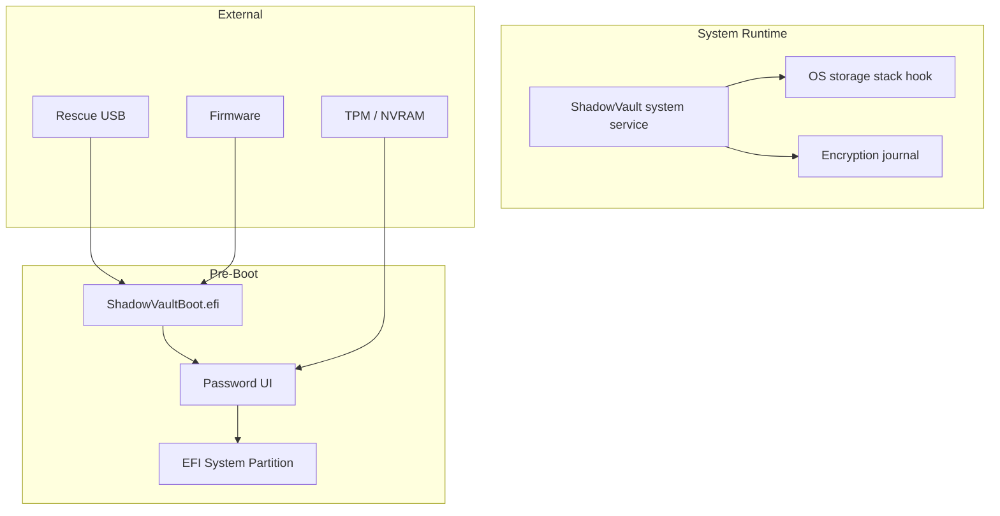

# Shadow Vault — Threat Model Addendum: System Encryption

| Field | Value |
|-------|-------|
| **Date** | 2026-07-05 |
| **Status** | Draft |
| **Scope** | Full-disk / system partition encryption (future) |
| **Parent** | `docs/threat-model.md` |

---

## Overview

This addendum extends the Shadow Vault v1 threat model to **pre-boot and system-volume** scenarios planned in Milestone 10. Assets and adversaries from the parent document still apply; this document adds boot-chain surfaces, firmware interactions, and rescue-media risks.

**Assumption:** System encryption ships only after container + mount maturity (M9). PBA runs in a **minimal TCB** smaller than the full OS.

---

## Additional Assets

| ID | Asset | Sensitivity | Location |
|----|-------|-------------|----------|
| SA1 | System VMK (SVMK) | Critical | Encrypted system headers; RAM during PBA only |
| SA2 | EFI boot binaries | High | ESP; rescue USB |
| SA3 | Encryption progress journal | High | Dedicated disk slice |
| SA4 | TPM sealed blobs | High | NVRAM / TPM |
| SA5 | Rescue USB contents | Critical | Removable media |
| SA6 | Hidden system partition existence | Critical | Partition layout / boot timing |
| SA7 | Sector keys in PBA | Critical | Transient RAM before chain-load |

---

## Additional Adversaries

| ID | Profile | Capability | Goal |
|----|---------|------------|------|
| ADV-S1 | Evil maid | Physical access between boots | Install bootkit, capture PIN |
| ADV-S2 | Firmware attacker | SPI flash, UEFI variable write | Persistent compromise |
| ADV-S3 | Cold boot attacker | RAM freeze at PBA | Extract SVMK |
| ADV-S4 | Coerced user at boot | Watch user enter PBA password | Learn credentials |
| ADV-S5 | Rescue media thief | Steal USB | Offline attack on rescue keys |

---

## Attack Surfaces (System)

---

## Threat Scenarios

### T-S01: Evil Maid Bootkit

| Field | Value |
|-------|-------|
| **Adversary** | ADV-S1 |
| **Surface** | ESP, boot order |
| **Impact** | Capture passphrase; exfiltrate SVMK |

**Mitigations:**

- Secure Boot + signed `ShadowVaultBoot.efi`
- ESP integrity check at PBA (hash compare, phase 2)
- User education: verify boot screen fingerprint
- Optional TPM PCR policy

**Residual:** Unsigned firmware or disabled Secure Boot.

---

### T-S02: Interrupted Encryption Brick

| Field | Value |
|-------|-------|
| **Adversary** | ADV-7 (DoS) / accidental |
| **Surface** | Journal, partial ciphertext |
| **Impact** | Unbootable system |

**Mitigations:**

- Journal-before-sector-commit (same as R-004 pattern)
- Rescue USB with decrypt-in-place or header restore
- PBA displays recovery mode when journal dirty

---

### T-S03: Hidden System Exposure

| Field | Value |
|-------|-------|
| **Adversary** | ADV-2 |
| **Surface** | Partition table, timing, size metadata |
| **Impact** | Proof of hidden OS |

**Mitigations:**

- Decoy outer system partition sizing
- No cleartext hidden markers (extends R-008)
- Boot menu timing obfuscation (phase 4)

**Residual:** Forensic statistical analysis of free space.

---

### T-S04: Rescue USB Credential Harvest

| Field | Value |
|-------|-------|
| **Adversary** | ADV-S5 |
| **Surface** | Rescue USB FAT partition |
| **Impact** | Offline brute force on backup header |

**Mitigations:**

- Argon2id on rescue header (same as container)
- Encourage keyfile + passphrase
- USB should not store user passphrase
- Tamper-evident rescue image signing

---

### T-S05: Cold Boot on PBA

| Field | Value |
|-------|-------|
| **Adversary** | ADV-S3 |
| **Surface** | PBA RAM |
| **Impact** | SVMK recovery |

**Mitigations:**

- Minimize PBA lifetime; wipe buffers before chain-load
- Document limitation (extends R-005, R-023)
- Optional reboot after failed attempts

---

## Trust Boundaries

| Boundary | Trusted side | Untrusted side |
|----------|--------------|----------------|
| PBA → OS loader | PBA after successful auth | OS before ShadowVault service starts |
| Firmware → PBA | Signed EFI when Secure Boot on | Unsigned modules |
| Rescue USB → disk | User-verified signed image | Found random USB |

---

## Mitigation Mapping

| Parent risk | System extension |
|-------------|------------------|
| R-001 | Same Argon2id profiles for SVMK |
| R-003 | Hidden system margin at partition planner |
| R-005 | PBA mlock; no swap in EFI |
| R-008 | Hidden system deniability profile |
| R-012 | M10 design-only gate enforced |
| R-023 | Auto-lock PBA; single-user boot session |

---

## Out of Scope

- Nation-state firmware implants
- Hardware backdoors in CPU/chipset
- Network-based remote unlock without user presence

---

## Review Cadence

| Gate | Review |
|------|--------|
| M10 | This addendum approved |
| Pre-EFI code | T-S01, T-S05 revisited |
| Beta system encrypt | Full red-team on rescue USB |

---

*Addendum to `docs/threat-model.md` — system encryption phase.*