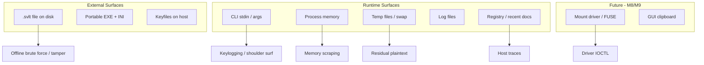

# Shadow Vault — Threat Model

| Field | Value |
|-------|-------|
| **Date** | 2026-07-05 |
| **Status** | Draft |
| **Scope** | v1 file containers, CLI, portable mode |

---

## Overview

This document defines assets, adversaries, attack surfaces, and mitigations for Shadow Vault. It follows a structured threat-modeling approach suitable for a cryptographic volume product handling high-value user data on potentially hostile hosts.

---

## Assets

| ID | Asset | Sensitivity | Location |
|----|-------|-------------|----------|
| A1 | User plaintext files | Critical | Decrypted in memory/cache; encrypted in `.svlt` |
| A2 | Volume Master Key (VMK) | Critical | Encrypted in headers; RAM when unlocked |
| A3 | Header derivation keys | Critical | Derived transiently from password/keyfiles |
| A4 | Passwords / passphrases | Critical | User input; wiped after KDF |
| A5 | Keyfile material | High | User filesystem; hashed for KDF input |
| A6 | Hidden volume existence | High | Plausible deniability asset |
| A7 | Container metadata (filenames, sizes) | High | Encrypted manifest |
| A8 | Journal / transaction records | Medium | Encrypted when unlocked state known |
| A9 | Portable config / recent volumes list | Medium | Host filesystem, registry |
| A10 | Application binaries | Medium | Supply chain integrity |

---

## Adversaries

| ID | Profile | Capability | Goal |
|----|---------|------------|------|
| ADV-1 | Casual thief | Physical USB access | Read container offline |
| ADV-2 | Forensic examiner | Disk imaging, host artifact analysis | Recover plaintext, prove hidden volume |
| ADV-3 | Malware on host | User privilege, keylogging, memory scrape | Capture password/VMK while unlocked |
| ADV-4 | Coerced user attacker | Social/legal pressure | Learn hidden volume password |
| ADV-5 | Network attacker | **Out of scope** — no network in v1 | N/A |
| ADV-6 | Insider maintainer | Repo access | Insert backdoor |
| ADV-7 | Denial-of-service | Corrupt/truncate container | Data unavailability |

---

## Assumptions

1. User chooses a strong password when not using keyfiles alone.
2. Host OS may be compromised during unlock; product still limits exposure window.
3. Attacker can obtain full copy of `.svlt` file offline.
4. Attacker cannot break XChaCha20-Poly1305 or Argon2id with practical parameters.
5. Side-channel resistance is best-effort on commodity CPUs (no HSM requirement in v1).

---

## Attack Surfaces

| Surface | Exposure | v1? |
|---------|----------|-----|
| `.svlt` ciphertext | Offline forever | Yes |
| Password entry (CLI) | Local | Yes |
| Keyfile paths | Local | Yes |
| Decrypted chunk cache | RAM | Yes |
| Swap / hibernation | Host-wide | Mitigated partially |
| Portable INI / cache | USB + host | Yes |
| Mount driver | Kernel | Milestone 9 |
| GUI password field | Clipboard, memory | Milestone 8 |

---

## Threat Scenarios & Mitigations

### T1: Offline Password Brute Force

| Attribute | Value |
|-----------|-------|
| Adversary | ADV-1, ADV-2 |
| Severity | High |
| Likelihood | High (if weak password) |

**Mitigation:**
- Argon2id default 256 MiB, t=3 (tunable higher)
- Minimum password policy warning (≥20 chars recommended)
- Keyfiles increase entropy
- No password hints stored

**Residual risk:** Weak passwords crackable given time/GPU farms.

---

### T2: Header Tampering / Bit Flips

| Attribute | Value |
|-----------|-------|
| Adversary | ADV-7 |
| Severity | Medium |
| Likelihood | Medium |

**Mitigation:**
- AEAD on all headers and manifest pages
- Backup header slot
- `verify` command detects corruption
- `repair` restores from backup
- Superblock CRC32 (detect only)

---

### T3: Wrong-Password Oracle

| Attribute | Value |
|-----------|-------|
| Adversary | ADV-2 |
| Severity | Medium |
| Likelihood | Low if implemented correctly |

**Mitigation:**
- Single generic error for AEAD fail vs HMAC fail
- Constant-time `header_key_confirm` check
- No early exit before full decrypt attempt

---

### T4: Hidden Volume Exposure via Outer Writes

| Attribute | Value |
|-----------|-------|
| Adversary | ADV-2, ADV-4 |
| Severity | Critical |
| Likelihood | Medium (user error) |

**Mitigation:**
- **Bitmap reservation:** hidden-span chunks marked `10` at `create-hidden` — outer alloc blocked always
- **Hard boundary:** outer writes cannot cross `hidden_offset` regardless of protection flag
- Hidden volume protection mode adds safety margin before `hidden_offset`
- Default safety margin 128 MiB / 5% (`uint64`)
- Deniability profiles (standard/strict) documented in `file-format-spec.md`

**Residual risk:** User mounts outer without protection and fills disk up to margin (not into hidden span).

---

### T5: Host Trace Leakage (Portable USB)

| Attribute | Value |
|-----------|-------|
| Adversary | ADV-2 |
| Severity | Medium |
| Likelihood | High on default apps |

**Mitigation:**
- Portable mode: config beside EXE
- `no_host_traces`: no recent list, no registry writes
- Temp file cleanup on exit
- Optional RAM-only log buffer

---

### T6: Memory Scrape While Unlocked

| Attribute | Value |
|-----------|-------|
| Adversary | ADV-3 |
| Severity | Critical |
| Likelihood | Medium on infected host |

**Mitigation:**
- `SecureBuffer` with `mlock`/`VirtualLock` where available
- Wipe VMK and derived keys on lock
- Auto-lock on idle (GUI/M9 — designed, partial CLI v1)
- Document threat: malware can read unlocked data

**Residual risk:** Cannot fully defend against compromised host while unlocked.

---

### T7: Swap / Hibernation Leakage

| Attribute | Value |
|-----------|-------|
| Adversary | ADV-2, ADV-3 |
| Severity | High |
| Likelihood | Medium |

**Mitigation:**
- Lock memory for key material
- Sensitive buffers not swapped when lock succeeds
- Document: disable hibernation for high-threat users
- Portable mode avoids pagefile hints where possible

---

### T8: Keyfile Substitution

| Attribute | Value |
|-----------|-------|
| Adversary | ADV-2 |
| Severity | High |
| Likelihood | Low |

**Mitigation:**
- Keyfile content hashed (SHA-256) + HMAC chain
- `keyfile_required` flag in header
- Warn if keyfile size/entropy low

---

### T9: Supply Chain / Backdoor

| Attribute | Value |
|-----------|-------|
| Adversary | ADV-6 |
| Severity | Critical |
| Likelihood | Low |

**Mitigation:**
- Minimal vendored deps (libsodium, argon2)
- Reproducible builds (goal)
- No auto-update / download
- GPLv3 source distribution
- CI build logs, signed tags (future)

---

### T10: Torn Write / Crash Corruption

| Attribute | Value |
|-----------|-------|
| Adversary | ADV-7, accidental |
| Severity | Medium |
| Likelihood | Medium |

**Mitigation:**
- Journal with commit records
- Replay on unlock
- `JOURNAL_DIRTY` superblock flag
- `repair` tool path

---

### T11: Plausible Deniability Compromise

| Attribute | Value |
|-----------|-------|
| Adversary | ADV-2, ADV-4 |
| Severity | High |
| Likelihood | Medium |

**Mitigation:**
- Hidden header in dedicated sector `0x2200` (same size as outer headers)
- **Strict profile:** no `HIDDEN_CONFIGURED` cleartext flag; `hidden_present=0` in outer encrypted header
- **Standard profile:** optional cleartext hint (user choice)
- KDF runs fixed Argon2id params for outer and hidden attempts; see T13
- User training: decoy outer content

**Residual risk:** Statistical analysis of entropy in hidden region; coercion attacks.

---

### T12: CLI Password in Process List / Shell History

| Attribute | Value |
|-----------|-------|
| Adversary | ADV-3 |
| Severity | Medium |
| Likelihood | Medium |

**Mitigation:**
- Password via prompt (not argv) by default
- `--password-file` documented as dangerous
- Wipe argv buffers where platform allows

---

## STRIDE Summary

| Threat | Category | Primary Mitigation |
|--------|----------|-------------------|
| Offline crack | Spoofing creds | Argon2id |
| Tampered header | Tampering | AEAD + backup |
| Deny access | Denial | Repair, backup header |
| Filename leak | Info disclosure | Encrypted manifest |
| VMK in swap | Info disclosure | Locked memory |
| Hidden exposure | Elevation | Protection margin |
| Backdoor dep | Elevation | Dependency policy |

---

## Security Requirements Traceability

| Req ID | Requirement | Threat |
|--------|-------------|--------|
| SR-01 | AEAD all metadata | T2 |
| SR-02 | Argon2id KDF | T1 |
| SR-03 | Secure wipe on lock | T6 |
| SR-04 | Constant-time compare | T3 |
| SR-05 | Hidden protection | T4 |
| SR-06 | Portable no-traces | T5 |
| SR-07 | Journal recovery | T10 |
| SR-08 | No network | T9 (surface reduction) |

---

### T13: KDF Timing / Salt Normalization

| Attribute | Value |
|-----------|-------|
| Adversary | ADV-2 |
| Severity | Medium |
| Likelihood | Low |

**Scenario:** Observer compares unlock duration across outer vs hidden salt to infer hidden volume use.

**Mitigation:**
- Identical Argon2id `m_cost`/`t_cost`/`p_cost` for outer and hidden headers
- Hidden unlock always performs full KDF even if sector empty (generic failure)
- No early-exit before KDF completes
- Pre-`create-hidden` hidden sector: random nonce + zero ciphertext/tag (format spec § Initial State); AEAD failure indistinguishable from wrong password

**Residual risk:** Forensic analyst may distinguish zero-tag uninitialized sector from valid initialized hidden header ciphertext.

---

### T14: Multi-Snapshot Diff (Superblock / Journal Flags)

| Attribute | Value |
|-----------|-------|
| Adversary | ADV-2 |
| Severity | Medium |
| Likelihood | Medium |

**Scenario:** Adversary compares two `.svlt` snapshots; `JOURNAL_DIRTY`, `HIDDEN_CONFIGURED`, or tail superblock drift reveals activity.

**Mitigation:**
- Document snapshot diff as residual risk
- Strict deniability: avoid setting `HIDDEN_CONFIGURED`
- Clean `lock` clears `JOURNAL_DIRTY` when possible
- No-host-traces mode avoids host-side snapshot tools logging paths

---

### T15: Truncated-Container Forensic Analysis

| Attribute | Value |
|-----------|-------|
| Adversary | ADV-2 |
| Severity | Medium |
| Likelihood | Low |

**Scenario:** Truncated copy reveals true `container_size` vs apparent size; hidden region at tail may show entropy discontinuity.

**Mitigation:**
- `verify` detects truncation via tail superblock mismatch
- Document: fill outer decoy sparingly; hidden at tail still shows high entropy if written
- Coercion / deniable auth remains out of scope (product limit)

---

## Out of Scope (v1)

- TEE / Secure Enclave / TPM sealing
- Anti-forensics for memory cold boot
- Kernel-level hidden OS
- Active anti-malware integration
- Legal/coercion protocols (deniable auth)

---

## Review Cadence

- Revisit at milestone 7 (hidden volumes), 8 (GUI), 9 (mount)
- Annual review or on major format change

---

*Self-contained threat model for Shadow Vault.*